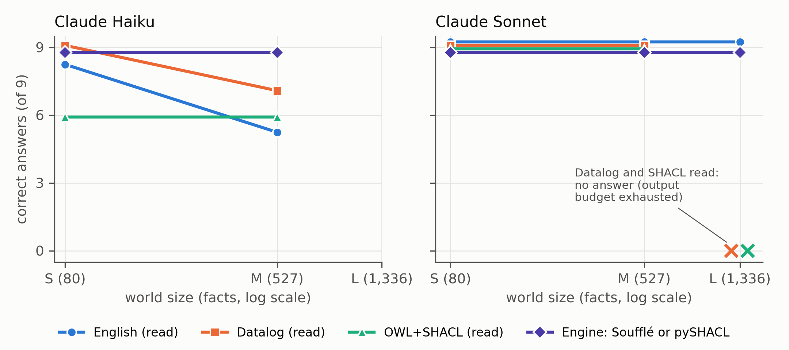
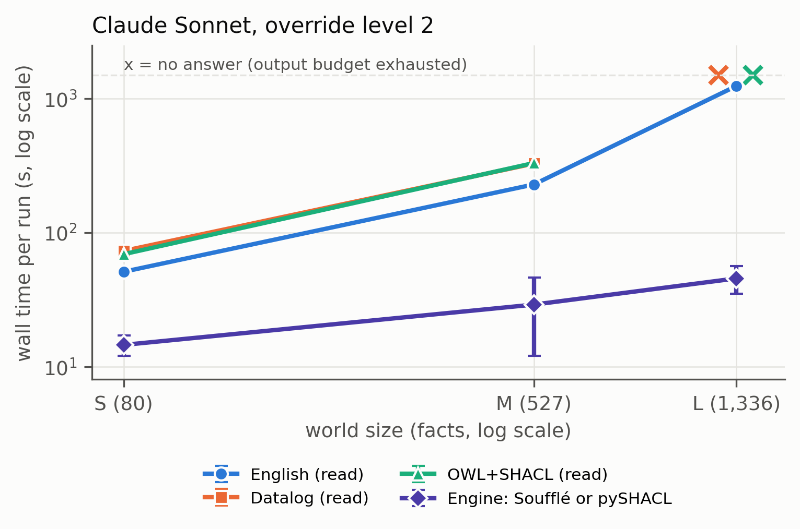

# Rules in Context: When Should a Language Model Evaluate a Policy Itself?

**English, Datalog and OWL + SHACL-AF compared under ambiguity and scale**

Matthias · Technical report · September 2026

## Abstract

Organisations increasingly ask large language models (LLMs) questions whose answers follow from written rules: approval policies, budget caps, entitlements. We ask two questions. Does the notation of the rules — English prose, Datalog, or an OWL ontology with SHACL-AF rules — change whether a model answers correctly, and whether it notices when the rules leave an answer open? And as the rule base and the data grow, when does the model need a deterministic engine rather than reading everything in context? Two studies on a synthetic procurement policy with machine-checked answer keys give consistent answers. Notation is not what matters; written interpretation decisions are. When the decisions were stated, 449 of the 453 answered questions were correct in every notation; when they were absent, models silently picked one reading in 15 of 87 answers. Scale is where the engine earns its place. Reading and evaluating 1,336 facts, two of three Sonnet reading runs exhausted a 64k-token output budget without ever answering and the third took 21 minutes, while the same model querying Soufflé or a pySHACL-materialised graph answered 9 of 9 questions at every size tested, in 12–56 seconds. The results support a division of labour: the model interprets and formulates queries; an engine evaluates.

## 1 Introduction

A rule base answers questions such as *is this request approved?*, *how much headroom does this cost centre have?*, or *which requests breach a cap?* With a capable LLM available, the tempting design is to place the rules and the data in the prompt and ask. The alternative is to encode the rules for a deterministic engine and let the model formulate queries. Both designs are in use; the choice is usually made by taste. This report replaces taste with measurement.

Before the experiments, the author held three working assumptions:

**A1 (notation).** For small problems it makes no difference how the ontology and rules are written.

**A2 (complexity).** Beyond some complexity a model cannot reliably determine the correct result without a deterministic helper such as a Datalog engine.

**A3 (size).** Beyond some size, placing the whole model in the context window stops being productive.

The two studies target these assumptions from different sides. Study 1 fixes a small world and varies the notation and the presence of written interpretation decisions. Study 2 fixes the decisions and varies size and rule structure, comparing models that read the rules with models that query an engine. Section 3 describes the materials both studies share; Sections 4 and 5 report the two studies; Section 6 returns to the assumptions.

**Contributions.**
(i) A reproducible benchmark with answer keys computed by Soufflé [8] and cross-checked by an independent implementation and by pySHACL [11], in three notations.
(ii) Evidence that the dominant error in policy reading is silent resolution of ambiguity, and that stating the decisions removes it in every notation.
(iii) A scaling pilot showing that when a model evaluates rules itself, the first symptom is cost, then omissions in exhaustive answers; and that the engine-backed design is flat in both accuracy and time.

## 2 Related work

*Reasoning over rules in language.* RuleTaker [1] and ProofWriter [2] showed transformers can emulate deductive reasoning over natural-language rules, with accuracy falling as proof depth grows. Dziri et al. [3] show that compositional tasks degrade with the number of reasoning steps, which suggests a per-step error rate that compounds. BoardgameQA [4] studies defeasible reasoning with conflicting rules and preferences, the analogue of our overrides, and reports substantial drops once conflicts appear.

*Long context.* Nominal context length overstates usable length: performance degrades with the position of relevant facts [5], on synthetic retrieval and aggregation tasks [6], and sharply when the question and evidence share no literal cue [7].

*Solver-augmented models.* Logic-LM [9] and LINC [10] have the model translate a problem into a formal language and delegate inference to a solver, improving faithfulness. Our engine arms follow the same division of labour, but with the rules given, so that we measure evaluation separately from translation.

*Formalisms.* We use Soufflé Datalog [8] with stratified negation and aggregates, and OWL 2 [12] with SHACL-AF SPARQL rules [13, 14] executed by pySHACL [11].

## 3 Materials

**Policy.** The policy throughout is a procurement approval policy. Its base data are a tree of cost centres, a reporting hierarchy, role-based approval limits, vendors with a status, booked spend and caps per cost centre, and purchase requests. Its derived notions include booked totals rolled up the tree, headroom, cap breaches against any ancestor, eligible approvers in the reporting chain, a vendor check, and approval. The override level adds an exception (emergency requests waive a vendor suspension), an exception to that exception (not for capital requests over 50,000), and a deny rule that overrides approval.

**Notations.** The same policy is written three ways: an English handbook, a Datalog program, and an OWL 2 ontology with SHACL-AF rules. The two studies vary which of these the model sees.

**Keys.** Every numeric and yes/no key is computed by Soufflé from the Datalog version. Two independent checks confirm the keys: a plain-Python implementation of the *English* rules reproduces every key in 28 of 28 generated worlds (Study 2), and the OWL + SHACL-AF version, executed by pySHACL, reproduces every derived relation tuple for tuple in 10 of 10 worlds.

**Runs and models.** Study 1 uses 50 runs recovered verbatim from the Hermes agent sessions of 31 August 2026 (49 DeepSeek V4 Pro, one GLM 5.3), and 30 runs by Claude Haiku, Sonnet and Opus as Claude Code subagents on 18 September 2026 (each Claude model once per arm). Study 2 uses 37 further Claude Code runs, Haiku and Sonnet only, on generated worlds. Reading-only runs were instructed to use no tool other than one read of the prompt file; every completed reading run reported a single read. Engine runs could only call a query script.

## 4 Study 1: interpretation under ambiguity

### 4.1 Setup

The English handbook leaves five questions of interpretation open (Table 1). Prompts that "state the decisions" settle C1–C4 in the material itself and deliberately leave C5 open, because there the correct status is `CONFLICT`. Each *scenario* probes one fork, and the model must return `ANSWER` (the material settles it), `AMBIGUOUS` (two readings give different answers) or `CONFLICT` (two rules apply with no precedence).

*Table 1. The open questions of interpretation.*

| | Question of interpretation | Decision where stated |
|--|--------------------------|--------------------|
| C1 | Does "committed spend" include pending requests? | No: booked spend only |
| C2 | Which dated rule version governs: request date or today? | Request date |
| C3 | Is "department" the cost centre or the org unit? | Cost centre |
| C4 | Do caps also apply to parent cost centres? (phase B) | Yes |
| C5 | Deny rule vs auto-approve rule | Left open: correct status is `CONFLICT` |

The arms vary two factors. The first is the notation: English, Datalog, or OWL. The second is whether the interpretation decisions are written into the material. The two factors are not freely combinable, and the constraints are what make the comparison informative: a Datalog program must state its decisions to run, and a plain OWL 2 ontology cannot state them at all, because OWL has no arithmetic, negation as failure or rule precedence. English can do either — so English with and without decisions brackets the formal notations.

Phase A uses 5 employees, 6 requests and 6 scenarios; phase B uses 17 cost centres, 41 employees, 37 requests and 8 scenarios. The arms are listed with their results in Table 2.

### 4.2 Results

*Table 2. Correct / graded answers. DeepSeek ran 3–5 times per arm (the mandatory-oracle row includes one GLM 5.3 run); Claude models ran once per arm.*

| Arm | Phase | DeepSeek V4 Pro | Haiku | Sonnet | Opus |
|------------------------------|---|-------|----|----|----|
| Handbook text (no decisions) | A | 17/23 | 4/6 | 4/6 | 5/6 |
| OWL 2 ontology (no decisions) | A | 25/28 | 3/6 | 5/6 | 5/6 |
| Text + interpretation notes | A | 23/23 | 6/6 | 6/6 | 6/6 |
| Text, decisions inline | A | 17/18 | 6/6 | 6/6 | 6/6 |
| Datalog | A | 22/23 | 6/6 | 6/6 | 6/6 |
| Datalog + optional oracle | A | 23/23 | – | – | – |
| Text + interpretation notes | B | 24/24 | 8/8 | 8/8 | 8/8 |
| Text, decisions inline | B | 24/24 | 8/8 | 8/8 | 8/8 |
| Text inline, C2 flipped for vendors (control) | B | 24/24 | 8/8 | 8/8 | 8/8 |
| Datalog | B | 24/24 | 7/8 | 8/8 | 8/8 |
| Datalog + one clarifying question | B | 24/24 | – | – | – |
| Datalog + mandatory oracle | B | 72/88 | – | – | – |
| OWL 2 + SHACL-AF rules | B | – | 7/8 | 8/8 | 8/8 |

**Decisions stated.** The arms whose material states the decisions graded 469 scenarios. Sixteen received no answer at all; every one of the sixteen comes from the two mandatory-oracle runs that never finished (below). Of the 453 answered, 449 were correct — in English, in Datalog and in OWL + SHACL-AF alike. The four misses were slips: two arithmetic errors in summing pending exposure, one reading of "department" as the org unit despite decision C3, and one use of today's manager limit where the request date governs.

**The mandatory-oracle arm.** The one weak row, Datalog + mandatory oracle at 72 of 88, has a procedural cause rather than an interpretive one: no oracle was actually served on 31 August. The nine runs that answered were 72 of 72. The remaining two runs never answered, having spent 3 and 42 tool calls building their own Datalog engine in place of the missing oracle; their 16 scenarios count as misses.

**Decisions absent.** The two arms that carry no decisions — the plain handbook and the pure OWL 2 ontology — graded 87 scenarios and missed 19. Fifteen were overreach: a definite answer where the key is `AMBIGUOUS`, that is, the model silently picked one reading. Four were the reverse, `AMBIGUOUS` where the material settles the answer; all four are in the OWL arm. The overreach concentrates on two forks, and neither is visible in the wording of its question. For C1, *does r4 pass the cap check?*, 9 of the 15 overreaches answered "passes, 114,000" — counting booked spend only, whereas counting the other pending requests gives 180,000 and a failure. Every model family made this error, Opus included. For C2, *is Bo a qualified approver for r2?*, 5 of 15 used today's limit. The remaining overreach was a single answer to the department question (C3). The one fork that is visible in its own wording — whether an exemption withdrawn later still applies — was flagged by every model. The deny/auto-approve conflict (C5) was reported as `CONFLICT` in all 78 answers given.

**Plain OWL.** The pure OWL arm failed in both directions: some models declared a directly answerable question "not expressible in OWL", others computed by hand the arithmetic that OWL cannot express.

### 4.3 Finding

What separates correct from incorrect answers is whether the decisions are written down, not the notation. Datalog appears to beat English only because the Datalog arm always carries its decisions; text with the same decisions performs identically. The hard case is the *invisible* fork, where the natural reading is so natural that the model does not notice a second one.

## 5 Study 2: scaling

### 5.1 Setup

A generator builds worlds from a cost-centre tree of given depth and branching, one manager per centre, analysts in the leaves, and about 0.8 requests per employee. Every world is emitted in five arms. Three are *reading* arms: the model reads the rules and the data — as English, as Datalog, or as OWL + SHACL-AF — and evaluates them itself. Two are *engine* arms: the model reads only the rules and a description of a query tool, and every query it writes is answered for it — by `./ask` over Soufflé, or by `./sparql` over the graph that pySHACL materialises. All interpretation decisions are stated, so every error in every arm is an error of computation. The pilot did not run every arm on every world: the OWL + SHACL-AF arms, both reading and engine, were run on the override worlds (L2) only, and Haiku was not run at L. Each world asks nine questions: three yes/no (one balanced negative), three numbers (a roll-up headroom, a reporting-chain count, a total approval count) and three sets (approved requests in a subtree, all cap breaches, all over-cap centres).

*Table 3. Generated worlds. L0 = plain rules; L2 = with overrides.*

| World | Cost centres | Employees | Requests | Facts | Prompt: English / Datalog / SHACL |
|---|------|------|------|------|----------------|
| S | 7 | 15 | 12 | 76–80 | 4 / 5 / 11 KB |
| M | 40 | 121 | 96 | 496–527 | 12 / 18 / 33 KB |
| L | 121 | 283 | 226 | 1,336 | 26 / 42 / 71 KB |

### 5.2 Results

*Table 4. Correct answers out of 9, one run per cell. "–": arm not run (see §5.1). "none": no answer; the run exhausted its 64k output-token budget (the SHACL run four times) and was stopped.*

| World | Model | English | Datalog | SHACL | Soufflé tool | SPARQL tool |
|------|------|-----|-----|-----|------|------|
| S, L0 | Haiku | 9 | 9 | – | 9 | – |
| S, L2 | Haiku | 8 | 9 | 6 | 9 | 9 |
| M, L0 | Haiku | 6 | 7 | – | 8 | – |
| M, L2 | Haiku | 5 | 7 | 6 | 9 | 9 |
| S, L0 | Sonnet | 9 | 9 | – | 9 | – |
| S, L2 | Sonnet | 9 | 9 | 9 | 9 | 9 |
| M, L0 | Sonnet | 9 | 9 | – | 9 | – |
| M, L2 | Sonnet | 9 | 9 | 9 | 9 | 9 |
| L, L2 | Sonnet | 9 | **none** | **none** | 9 | 9 |

**Accuracy.** Haiku's reading runs lose answers already at S (English 8/9, SHACL 6/9) and more by about 500 facts. Sonnet's English reading was correct through 1,336 facts, including a 164-member set. Pooling all reading runs that answered: 12 of 63 set answers, 5 of 63 numbers and 1 of 63 yes/no answers were wrong — and the wrong sets were wrong by omission far more than by addition. One run listed 16 of 51 cap breaches; another missed an ancestor-level breach and approved a request it should have refused; counts derived from incomplete sets were wrong in turn. The engine arms made one error in 126 answers: Haiku counted 38 rows where the engine returned 39.

**Cost.** On the override worlds, Sonnet's English runs took 51 s, 229 s and 1,246 s at S, M and L — a 24-fold increase in time for a 17-fold increase in facts. At L the English run hit the 64k output limit twice before answering on its third attempt; the Datalog and SHACL runs exhausted the budget and never answered (the SHACL run four times, 256k tokens of hidden reasoning). Whether one of three reading runs finishes is plausibly chance. The engine runs took 12–56 s at every size and used about 3,000 output tokens at L.

**Engines.** pySHACL took 0.9 s, 6.6 s and 16.5 s to materialise S, M and L; Soufflé takes milliseconds. The models wrote correct SPARQL — aggregates and property paths included — as readily as Datalog queries.

**Overrides.** Two layers of exceptions did not make the pilot measurably harder than the plain rules for either model.

## 6 Discussion

**A1 holds for syntax, not for expressiveness.** At small scale the notation is irrelevant *provided it can state the decisions*. Plain OWL cannot, and fails like undecided English.

**A2 holds, but the threshold belongs to the model, and cost arrives before errors.** A model evaluating rules itself pays per derived fact. The first observable symptom is time and tokens; the first accuracy failures are exhaustive answers, which require a universal check (*no cap is breached*, *all requests that…*) and therefore every step to succeed. If each inference step succeeds with probability *p*, a *k*-step answer succeeds with roughly *p* to the power *k*; a set-valued answer multiplies *k* by the size of the set. On accuracy, the threshold lay at roughly 500 facts for Haiku and beyond 1,336 for Sonnet; on budget, both of Sonnet's non-English reading arms failed at about 1,300 facts.

**A3 holds, and notation re-enters through length.** When the model reads everything, the same world costs 26 KB as English, 42 KB as Datalog and 71 KB as OWL + SHACL, and the failures follow that order. Behind an engine, notation is invisible to the model; only the query language is.

**Where the helper does not help.** An engine removes evaluation errors. It does not remove interpretation errors (Study 1); it forces them to be decided when the rules are written. And it moves errors to the interface: choosing the right query and reading its output. The one engine error was a miscounted result list; a count query would have prevented it.

The design that survives both studies is a division of labour: the model interprets the question and formulates queries; the engine evaluates; the decisions live in the rules, where they can be reviewed.

## 7 Threats to validity

- **Sample size.** Study 2 ran once per cell and one seed per world; single-answer differences are noise, and the L budget failures in particular need replication.
- **Model access.** Claude runs used subagents with default settings; exact model versions, sampling temperature and reasoning budgets were not controlled, and some token counts in the logs are unreliable.
- **Keys.** `AMBIGUOUS` keys in Study 1 are judgements (one may argue that "committed spend" means booked spend); numeric and yes/no keys are machine-checked.
- **Balance.** Study 1 phase B yes/no keys are all "yes".
- **Ceiling.** Study 1 phase B and Study 2 overrides at depth 2 did not separate arms.
- **Construct.** Rules were given, not translated from English by the model; the translation step, where interpretation errors arise, is not measured in Study 2.
- **Recovery.** Study 1's original working files were lost; prompts and transcripts were recovered verbatim from the agent's session store, and one process listing was redacted.

## 8 Conclusions and future work

Written decisions, not notation, determine whether an LLM reads a policy correctly; the dangerous ambiguity is the one the reader does not see. When a model must evaluate rules itself, quality degrades with size — first in cost, then in exhaustive answers — and at around a thousand facts even a strong model can fail to finish. Placing the rules behind an engine, Soufflé or SHACL-AF alike, kept accuracy and time flat across every size tested.

Next steps: three or more seeds and repetitions per cell through the API with fixed reasoning budgets and exact token accounting; an XL world of about 4,000 facts; override chains four to six deep with explicit priority rules (specific over general, later over earlier); model-performed translation from English to rules, to measure where interpretation errors enter an engine-backed pipeline; and count queries in the tool interface.

## Reproducibility

All prompts, keys, oracles, generators, raw transcripts and scored results are in this repository; see `README.md`. `make verify` recomputes every key and checks all equivalences; `make figures` regenerates the figures from the result files.

## References

[1] P. Clark, O. Tafjord, K. Richardson. Transformers as Soft Reasoners over Language. *IJCAI* 2020.

[2] O. Tafjord, B. Dalvi, P. Clark. ProofWriter: Generating Implications, Proofs, and Abductive Statements over Natural Language. *Findings of ACL-IJCNLP* 2021.

[3] N. Dziri et al. Faith and Fate: Limits of Transformers on Compositionality. *NeurIPS* 2023.

[4] M. Kazemi et al. BoardgameQA: A Dataset for Natural Language Reasoning with Contradictory Information. *NeurIPS Datasets and Benchmarks* 2023.

[5] N. F. Liu et al. Lost in the Middle: How Language Models Use Long Contexts. *TACL* 12, 2024.

[6] C.-P. Hsieh et al. RULER: What's the Real Context Size of Your Long-Context Language Models? *COLM* 2024.

[7] A. Modarressi et al. NoLiMa: Long-Context Evaluation Beyond Literal Matching. *ICML* 2025.

[8] H. Jordan, B. Scholz, P. Subotić. Soufflé: On Synthesis of Program Analyzers. *CAV* 2016.

[9] L. Pan, A. Albalak, X. Wang, W. Y. Wang. Logic-LM: Empowering Large Language Models with Symbolic Solvers for Faithful Logical Reasoning. *Findings of EMNLP* 2023.

[10] T. X. Olausson et al. LINC: A Neurosymbolic Approach for Logical Reasoning by Combining Language Models with First-Order Logic Provers. *EMNLP* 2023.

[11] pySHACL: a Python validator for SHACL, with SHACL-AF rule support. https://github.com/RDFLib/pySHACL

[12] W3C OWL Working Group. OWL 2 Web Ontology Language Document Overview (Second Edition). W3C Recommendation, 2012.

[13] H. Knublauch, D. Kontokostas. Shapes Constraint Language (SHACL). W3C Recommendation, 2017.

[14] H. Knublauch, D. Allemang, S. Steyskal. SHACL Advanced Features. W3C Working Group Note, 2017.
