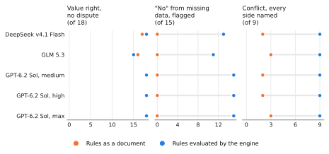
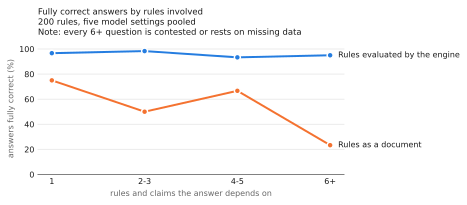
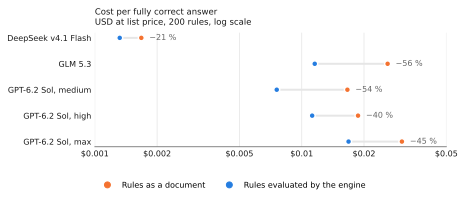

# Beyond Context Graphs and Layers: The Warrant Dimension for Data Agents

Matthias Autrata · November 2026 · draft

> "We always give healthcare companies an extra 10% because their procurement cycles are brutal."

Foundation Capital used this line to motivate the need for context graphs (Gupta and Garg 2025), and rightly so.
The rule sits in no CRM. It lives in a few heads and in onboarding lore. An agent that cannot see it quotes the
wrong price.

The industry's answer is more context. Context layers gather definitions, metrics and tribal knowledge; context
graphs record the trail of past decisions. Both make the 10% visible to an agent.

Visibility is a weaker property than it sounds. The 10% is a rule. It has an owner and an effective date, other
rules can override it, and it cannot apply until the customer's industry is known. Hand an agent that sentence, or
show it a precedent, and it must re-derive all of that, probabilistically, on every call. Context supplies the
grounds; what the agent lacks is the warrant (Toulmin 1958): the entitlement to move from those grounds to a
conclusion.

To measure the difference, we gave three models, from low-cost to frontier, identical questions about a procurement
domain with 200 rules. They had the rules either as a well-written instruction document, or formalized and
evaluated by a deterministic engine they called as a tool.

With the document, the models usually found the right number, but they treated unknown as false:

| Five model settings, 200 rules | Rules as a document | Rules evaluated by the engine |
| --- | --- | --- |
| A "no" resting only on missing data, flagged (rest of answer right) | 0 of 75 answers | 11-15 of 15 per setting |
| A conflict between rules, every side named | 2-3 of 9 per setting | 9 of 9 per setting |
| Model cost per fully correct answer | baseline | 21% to 56% lower |

Teams already write these rules in Genie (Databricks) and Cortex (Snowflake) instruction files and internal notes.
We propose to change where that writing ends up: in records a machine can check and evaluate, instead of prose left
for a model to interpret.

## 1 Evaluate, don't read

An essay on input handling, "Parse, don't validate" (King 2019), describes a shift in how programs treat their
input. A validator checks the input but does not return or record what the check established. Later steps must
trust the check or repeat it. A parser does the same checks once and returns a value whose type keeps what was
established.

Rules for data agents need the same shift. An agent that reads a rule applies it in passing while composing an
answer, and keeps nothing it can show. Formalizing the rule is the parse: done once, and checked when the rule is
loaded. Evaluating it returns the typed value: an answer whose standing is yes; no; no, resting only on the absence
of a record; undetermined, because an input it needs is missing; or contested between named owners. Each answer
comes with the rules and claims it rests on.

The engine decides whether a rule applies. The model decides what to ask, supplies the inputs, and explains what
comes back. Mistakes at that boundary are still possible; section 6 says what we did and did not measure about
them.

## 2 What a warrant is

The data model says what the data is. A warrant says what follows from it, who says so, and how firm the result is.
The warrants a domain needs are its warrant dimension, which runs alongside the data model rather than on top of
it: a table, a column, a measure or a business term can each carry claims and rules, with their own owners and
dates. The name matters less than what it requires: an explicit semantics for deriving conclusions, evaluated by a
program.

Here is the healthcare rule written as a record. The notation is illustrative; what matters is which questions it
answers.

```
rule        healthcare-extra-discount
owner       head of commercial sales
applies     from 2026-01-01
if          customer.industry = healthcare
then        extra discount of 10 per cent
yields to   finance discount cap, unless a VP exception is recorded
if unknown  no discount, marked as resting only on the missing industry
```

Asked about a renewal whose customer has no recorded industry, the engine answers "no, resting only on the absence
of a recorded industry", and names this rule. A model that read the sentence tends to answer a plain "no", which
claims something the data does not show; section 4 measures how often.

A warrant answers five questions. In the original account (Toulmin 1958) the warrant comes with backing, a
qualifier and possible rebuttals. The five questions are an engineering version of that bundle.

| Part | The question it answers |
| --- | --- |
| Source and authority | Who says this holds, and on what mandate? |
| Validity | From when to when does it apply? |
| Precedence | When two rules disagree, which one wins? |
| Conflict | What if neither wins? Then the answer is "contested", with every side named. |
| Completeness | Does a "no" mean that a fact says no, or only that nothing was found? |

Take an example that is quite plausible in a large organization. Six policies apply to a capital purchase request
of $8,000:

| Policy owner | Says | Stated to prevail over |
| --- | --- | --- |
| Finance | capitalise | tax rules 1 and 2 |
| Controller | capitalise | nothing |
| Audit | expense | finance's rule |
| Tax, rule 1 | expense | nothing |
| Tax, rule 2 | expense | nothing |
| Tax, rule 3 | expense | nothing |

Nothing prevails over the controller's rule, and nothing on the capitalise side prevails over audit's rule or tax
rule 3. Neither side wins. The correct answer is "contested: finance and the controller against audit and tax", and
both "expensed" and "capitalised" are wrong. Rules interact!

The distinction between false and unknown is old: SQL has had a third truth value for decades, and logic
programming distinguishes failure from falsity. What we add is where it gets lost in data agents. An answer of "no"
can stand for three results: a fact says no, nothing was found, or the rules disagree and nothing decides. Given
the rules as text, every model we tested reported inaccurately.

## 3 Why it looks like context

The essays that defined this category already contain warrants. Foundation Capital's first example is one. Its
remedy is to capture such exceptions as decision traces, so that agents can search precedent. It says that rules
must be evaluated and conflicts resolved, but describes no mechanism. The a16z essay on context layers (Cui and Li
2026) treats business logic and tribal knowledge as context for the agent to read, much like a rules file for a
coding agent. Snowflake's essay on an agent context layer (Klahr and Samdani 2026) goes furthest: policy as
machine-enforceable rules, managed playbooks, and decision memory that keeps justifications. The essay describes no
mechanism for evaluating them, and does not discuss conflicts between rules or answers that rest on missing data.
Rippletide's decision context graph, as VentureBeat reports it (Plumb 2026), holds formal, time-scoped rules that
an agent checks before acting; the report describes no method for precedence and gives no measurements. None of
this says what these products do internally; it says what the published descriptions establish.

Their vision is right. Exceptions, overrides, and approvals are where enterprise knowledge lives, and agents need
them. We sharpen one point: agents can rely on these rules only if they are formalized and evaluated. Handed to the
model, as text or as precedent to imitate, they remain rules for an LLM to interpret. A context graph can store
rules as well as traces. Representing and retrieving rules does not, by itself, establish that they are evaluated
correctly.

The distinction is between retrieval and evaluation. Context is testimony: something asserted, with a source and a
date, which retrieval can return. A precedent is testimony too, since it records what was allowed in an earlier
case. A warrant licenses a conclusion about a case nobody has decided yet, and another rule can defeat it.
Retrieval can return a decision that was already made; for a new case, something has to derive one.

The same distinction explains why a larger ontology does not close the gap. An ontology names things and fixes how
they relate, and the method relies on that. Our first study in this series (Autrata 2026) compared the same policy
as English, as Datalog, and as an OWL ontology with SHACL rules. Once the interpretation decisions were written
down, 449 of the 453 answers, pooled across the three notations, were correct, and the four misses were slips of
arithmetic or reading. A plain OWL 2 ontology could not state those decisions at all, because OWL has no
arithmetic, negation as failure or rule precedence. Notation mattered less than whether the decisions were stated,
and stated decisions are rules.

The work this builds on is older than any of these essays. Defeasible logic describes rules that can lose to
superior rules (Antoniou et al. 2006), and under the well-founded semantics it keeps "not provable" apart from
"false" (Maier 2011). DMN decision tables have hit policies for overlapping rules (OMG DMN), XACML has
rule-combining algorithms and an indeterminate result (OASIS 2013), and policy engines such as OPA return
"undefined" when no rule applies (Open Policy Agent). Each covers part of what a warrant needs. Section 5 says what
we had to add.

## 4 What we measured

We gave three models the same 16 questions about a procurement domain with 100,000 purchase requests and 200 rules,
three times each. DeepSeek v4.1 Flash and GLM 5.3 are low-cost models; GPT-6.2 Sol, a widely used frontier model,
ran at medium, high and maximum reasoning effort. Every set-up had the same data, schema documentation and
read-only SQL access. One had the rules as a document generated from the rule base; the other had an engine that
evaluates the same rule base. Expected answers were computed and double checked. An answer counts as fully correct
only if its value, its status, the sides of any conflict and its missing-data flag are all right. The companion
paper gives the full design.

Without the rules, DeepSeek answered 6 of 96 policy questions correctly. The knowledge that decides the answers is
not in the schema.

With the rules, value accuracy overstates reliability. Both set-ups got the values right; only the engine set-up
got the standing of the answers right.



*Left: undisputed questions with the value right, of 18. Middle: questions whose "no" rests only on missing data,
answered correctly with the flag, of 15. Right: conflicts with every side named, of 9. Where only one dot shows,
both set-ups scored the same.*

The document set-up never flagged a "no" that rested only on missing data: none of 75 answers across five model
settings. Telling the model to flag it, raising its reasoning effort 26-fold, and giving it a tool to look up any
rule each left the gap open. Finding the rules was not what the engine set-up added, since looking them up did not
reproduce its results. What it added came with the engine: exact evaluation, with statuses, sides and qualifiers
computed for the model to report.



*Fully correct answers by the number of rules and claims an answer depends on, pooled over five model settings,
four questions per point. At this size every question that depends on six or more rules is a conflict or rests on
missing data.*

The gap grows with the number of rules an answer depends on. The document set-up falls from 75 to 23 per cent fully
correct; the engine set-up stays above 90.



*Model cost at list price per fully correct answer, 200 rules. It leaves out building the engine and converting the
rules. At 100 rules with DeepSeek the document set-up was slightly cheaper, $0.0007 against $0.0009.*

The engine set-up was also cheaper, by 21% to 56% per fully correct answer at 200 rules. It fetches only what a
question needs, while the document set-up re-reads every rule at every step, and it gets more answers right.

## 5 What it takes

Every rule in this project was first written in plain language, then converted into a rule record like the one in
section 2: condition, conclusion, owner, dates, and what it overrides. An AI model can draft the record; a person
confirms it. The plain wording stays attached as documentation. We did not measure how long this takes on real
instruction files.

A rule base is checked when it is loaded, and only one that passes reaches the engine. The checks catch errors that
would otherwise reach an answer silently: a second definition of a term, a rule that overrides itself through a
chain of exceptions, precedence between owners that is not a consistent order, a total that would double-count
across a hierarchy, and a rule that concludes from missing data without stating whether that data is complete. A
rejection names the rules involved. Running new rules against sample questions with the expert who owns them often
turns up an exception nobody had written down. This is a significant challenge in human-maintained rules that are
written as text only.

The evaluation needs three things that answers must not lose: a conflict kept open as "contested", with every side
named; precedence applied only where an owner has stated it; and a mark on any answer that rests on data not known
to be complete. Standard rule engines and policy languages cover parts of this, and on every platform we tried the
rest was a thin layer of a few hundred lines. The method carries the result, not the platform it runs on. The data
stays in the existing database; the engine sends one bounded query per business term, not one per record.

The method moves some decisions to people, and an organization adopting it has to say who makes them. Each rule has
an owner who signs off changes. Precedence between owners has to be stated by someone with the authority to state
it; until then the engine reports their rules as contested. Unless someone declares a source complete, every "no"
drawn from its silence stays qualified. A contested answer goes to whoever owns the dispute, and the engine names
them without deciding for them.

## 6 Limits and next steps

This benchmark is based on one synthetic domain with 16 questions asked three times. Each question contributes
three answers to every count, and we report counts, not confidence intervals. We tested three models, one at three
effort levels. The schema is small; enterprise schemas reach more than a thousand tables, which is a separate
problem. Our no-rules baseline had schema documentation but not a vendor's semantic layer of predefined measures,
and we did not compare against a stronger document set-up with retrieval of relevant rules or against a commercial
rules engine. The engine set-up is a bundle (evaluation, term resolution, scoped retrieval of rules, computed
statuses); the controls separate retrieval, not the rest, so the results show what this engine-mediated set-up
changes, not the share due to evaluation alone. We did not measure separately how often the model chose the wrong
question for the engine or misreported its answer; in the engine set-up such errors are among the 0-8 of 48 answers
per setting that were not fully correct.

Given those limits, our next steps are to convert a production team's existing instruction files and measure the
effort and the errors found; to repeat the comparison at production schema sizes; to add a stronger document
baseline and a semantic layer to the no-rules baseline; and to separate the parts of the bundle, giving a model the
relevant rules and resolved inputs with and without computed statuses.

The companion paper reports the design, every result and how to reproduce it. All data, rules, prompts, run records
and scoring code are in the repository, and every number here can be reproduced from the stored run records without
new model calls (`paper/v3/whitepaper/figures.py`).

## 7 Conclusion

Data agents need the knowledge that decides answers: definitions, exceptions, precedence, approvals. Context layers
and context graphs make that knowledge visible to them, and that was the necessary first step. A rule that is only
visible, though, is applied by the model, in passing, each time it is needed. In our measurements, models that read
the rules found the right values and lost the rest. They reported a plain "no" where the data was merely silent,
and they rarely named every side when rules conflicted. Asking them to take care, giving them more reasoning, or
letting them look rules up did not change this.

Writing rules down is half the job; the other half is deciding who applies them. When the model applies them, you
get the right number with the wrong standing, and an accuracy metric won't show it. The remedy is to make the rules
part of the system instead of part of the prompt. Write each rule once, as a record with an owner, dates and
precedence. Check the rule base when it is loaded, so that conflicting definitions and circular overrides never
reach an answer. Let an engine evaluate the rules, and let the model ask the engine and explain what it returns.
Every answer then states its standing and the rules it rests on.

In practice the distinction gives a test for any agent architecture. Ask what evaluates the rules, and whether an
answer can say that it rests on missing data or on a dispute between owners. If the rules are applied by the model
reading them, expect answers that are right on values and silent on standing, however good the context.

The case for doing this is practical. Teams already spend the effort of writing these rules down, in instruction
files that a model reads and may or may not apply. The same rules, kept as checked records, give answers that say
when they rest on missing data and who disagrees when rules conflict, which is what an analyst, an auditor or a
manager reading a dashboard needs to know. The gap was widest on questions involving several interacting rules, and
enterprise rule bases contain exactly such interactions, which makes them the natural place to test the approach.
At 200 rules the engine set-up also cost less per correct answer. The context layer tells an agent what is known;
the warrant dimension lets it say, with reasons, what follows.

## References

- Antoniou, G., Billington, D., Governatori, G. and Maher, M. J. (2006). Embedding defeasible logic into logic
  programming. *Theory and Practice of Logic Programming* 6 (6).
- Autrata, M. (2026). Rules in Context: English, Datalog and OWL + SHACL-AF compared under ambiguity and scale.
  `paper/v1/PAPER.md`.
- Cui, J. and Li, J. (2026). Your Data Agents Need Context. a16z, 10 March.
  https://a16z.com/your-data-agents-need-context/
- Gupta, J. and Garg, A. (2025). AI's trillion-dollar opportunity: Context graphs. Foundation Capital, 22 December.
  https://foundationcapital.com/ideas/context-graphs-ais-trillion-dollar-opportunity
- King, A. (2019). Parse, don't validate. 5 November.
  https://lexi-lambda.github.io/blog/2019/11/05/parse-don-t-validate/
- Klahr, J. and Samdani, R. (2026). The Agent Context Layer for Trustworthy Data Agents. Snowflake, 19 March.
  https://www.snowflake.com/en/blog/agent-context-layer-trustworthy-data-agents/
- Maier, F. (2011). Interdefinability of defeasible logic and logic programming under the well-founded semantics.
  arXiv:1106.1957.
- OASIS (2013). eXtensible Access Control Markup Language (XACML) Version 3.0.
- OMG DMN. Object Management Group, Decision Model and Notation.
- Open Policy Agent. Policy Language (Rego) documentation. https://www.openpolicyagent.org/docs/latest/policy-language/
- Plumb, T. (2026). Enterprise AI agents keep failing because they forget what they learned. VentureBeat, 21 May.
  https://venturebeat.com/ai/enterprise-ai-agents-keep-failing-because-they-forget-what-they-learned/
- Toulmin, S. (1958). *The Uses of Argument*. Cambridge University Press.

Companion paper: *AI-Ready Data: Syntax, Ontology and Computed Warrants Compared*, `paper/v3/companion/`.
Repository: https://github.com/matthiasautrata/llm-policy-reasoning. Paths in this paper are relative to its main
branch.
