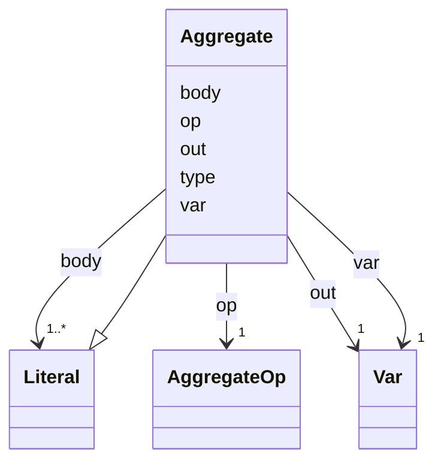

---
search:
  boost: 10.0
---

# Class: Aggregate 


_[:agg :sum ?x [literal ...] ?out]: sum or count of ?x over the proven solutions of the conjunction (SEMANTICS.md, Aggregates)._


<div data-search-exclude markdown="1">


URI: [slice:Aggregate](https://example.org/llm-policy-reasoning/spike-v3/slice/Aggregate)





## Inheritance
* [Literal](Literal.md)
    * **Aggregate**


## Slots

| Name | Cardinality and Range | Description | Inheritance |
| ---  | --- | --- | --- |
| [op](op.md) | 1 <br/> [AggregateOp](AggregateOp.md) |  | direct |
| [var](var.md) | 1 <br/> [Var](Var.md) |  | direct |
| [body](body.md) | 1..* <br/> [Literal](Literal.md) |  | direct |
| [out](out.md) | 1 <br/> [Var](Var.md) |  | direct |
| [type](type.md) | 1 <br/> [String](String.md) |  | [Literal](Literal.md) |


## Identifier and Mapping Information


### Schema Source


* from schema: https://example.org/llm-policy-reasoning/spike-v3/slice


## Mappings

| Mapping Type | Mapped Value |
| ---  | ---  |
| self | slice:Aggregate |
| native | slice:Aggregate |


## LinkML Source

<!-- TODO: investigate https://stackoverflow.com/questions/37606292/how-to-create-tabbed-code-blocks-in-mkdocs-or-sphinx -->

### Direct

<details>
```yaml
name: Aggregate
description: '[:agg :sum ?x [literal ...] ?out]: sum or count of ?x over the proven
  solutions of the conjunction (SEMANTICS.md, Aggregates).'
from_schema: https://example.org/llm-policy-reasoning/spike-v3/slice
is_a: Literal
attributes:
  op:
    name: op
    from_schema: https://example.org/llm-policy-reasoning/spike-v3/slice
    domain_of:
    - Comparison
    - Aggregate
    - Expr
    range: AggregateOp
    required: true
  var:
    name: var
    from_schema: https://example.org/llm-policy-reasoning/spike-v3/slice
    domain_of:
    - Output
    - Is
    - Aggregate
    range: Var
    required: true
    inlined: true
  body:
    name: body
    from_schema: https://example.org/llm-policy-reasoning/spike-v3/slice
    domain_of:
    - Rule
    - Aggregate
    range: Literal
    required: true
    multivalued: true
    inlined_as_list: true
  out:
    name: out
    from_schema: https://example.org/llm-policy-reasoning/spike-v3/slice
    rank: 1000
    domain_of:
    - Aggregate
    range: Var
    required: true
    inlined: true

```
</details>

### Induced

<details>
```yaml
name: Aggregate
description: '[:agg :sum ?x [literal ...] ?out]: sum or count of ?x over the proven
  solutions of the conjunction (SEMANTICS.md, Aggregates).'
from_schema: https://example.org/llm-policy-reasoning/spike-v3/slice
is_a: Literal
attributes:
  op:
    name: op
    from_schema: https://example.org/llm-policy-reasoning/spike-v3/slice
    owner: Aggregate
    domain_of:
    - Comparison
    - Aggregate
    - Expr
    range: AggregateOp
    required: true
  var:
    name: var
    from_schema: https://example.org/llm-policy-reasoning/spike-v3/slice
    owner: Aggregate
    domain_of:
    - Output
    - Is
    - Aggregate
    range: Var
    required: true
    inlined: true
  body:
    name: body
    from_schema: https://example.org/llm-policy-reasoning/spike-v3/slice
    owner: Aggregate
    domain_of:
    - Rule
    - Aggregate
    range: Literal
    required: true
    multivalued: true
    inlined: true
    inlined_as_list: true
  out:
    name: out
    from_schema: https://example.org/llm-policy-reasoning/spike-v3/slice
    rank: 1000
    owner: Aggregate
    domain_of:
    - Aggregate
    range: Var
    required: true
    inlined: true
  type:
    name: type
    from_schema: https://example.org/llm-policy-reasoning/spike-v3/slice
    rank: 1000
    designates_type: true
    owner: Aggregate
    domain_of:
    - Literal
    - RuleTerm
    range: string
    required: true

```
</details></div>