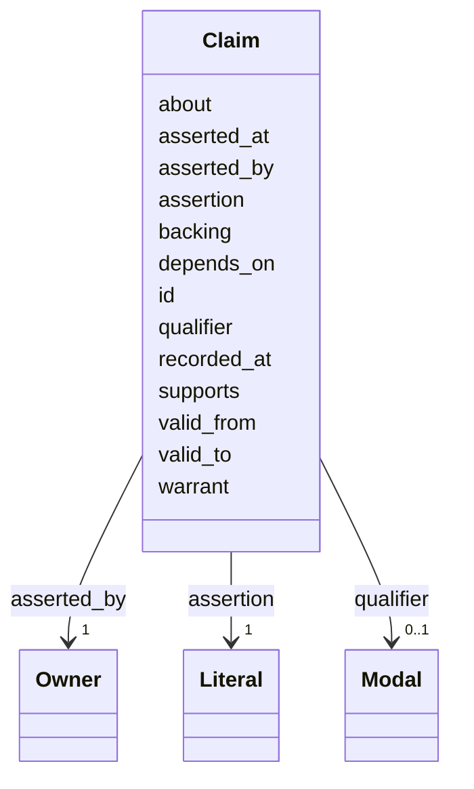

---
search:
  boost: 10.0
---

# Class: Claim 


_A Toulmin claim: an assertion about an asset by an asserter, in force from valid_from to valid_to (inclusive; open when absent), with warrant, backing and qualifier. Claims are flat (PLAN-v3-integrity §1.1): a claim holds only if every depends_on member holds (a failing one rebuts it); a failing supports member leaves it holding with a qualifier that lists it. Each claim carries its own asserter and times; nothing is inherited. recorded_at is provenance (when the record entered the store), not evidence._


<div data-search-exclude markdown="1">


URI: [slice:Claim](https://example.org/llm-policy-reasoning/spike-v3/slice/Claim)





<!-- no inheritance hierarchy -->

## Slots

| Name | Cardinality and Range | Description | Inheritance |
| ---  | --- | --- | --- |
| [id](id.md) | 1 <br/> [String](String.md) |  | direct |
| [about](about.md) | 1 <br/> [String](String.md) |  | direct |
| [assertion](assertion.md) | 1 <br/> [Literal](Literal.md) | A literal, e | direct |
| [asserted_by](asserted_by.md) | 1 <br/> [Owner](Owner.md) |  | direct |
| [asserted_at](asserted_at.md) | 1 <br/> [date](date.md) |  | direct |
| [valid_from](valid_from.md) | 1 <br/> [date](date.md) |  | direct |
| [valid_to](valid_to.md) | 0..1 <br/> [date](date.md) |  | direct |
| [warrant](warrant.md) | 0..1 <br/> [String](String.md) |  | direct |
| [backing](backing.md) | 0..1 <br/> [String](String.md) |  | direct |
| [qualifier](qualifier.md) | 0..1 <br/> [Modal](Modal.md) |  | direct |
| [depends_on](depends_on.md) | * <br/> [String](String.md) | Claim ids this claim requires | direct |
| [supports](supports.md) | * <br/> [String](String.md) | Claim ids that support this claim | direct |
| [recorded_at](recorded_at.md) | 1 <br/> [date](date.md) | When the record entered the store (provenance; no rule body reads it) | direct |


## Usages

| used by | used in | type | used |
| ---  | --- | --- | --- |
| [Slice](Slice.md) | [claims](claims.md) | range | [Claim](Claim.md) |


## Identifier and Mapping Information


### Schema Source


* from schema: https://example.org/llm-policy-reasoning/spike-v3/slice


## Mappings

| Mapping Type | Mapped Value |
| ---  | ---  |
| self | slice:Claim |
| native | slice:Claim |


## LinkML Source

<!-- TODO: investigate https://stackoverflow.com/questions/37606292/how-to-create-tabbed-code-blocks-in-mkdocs-or-sphinx -->

### Direct

<details>
```yaml
name: Claim
description: 'A Toulmin claim: an assertion about an asset by an asserter, in force
  from valid_from to valid_to (inclusive; open when absent), with warrant, backing
  and qualifier. Claims are flat (PLAN-v3-integrity §1.1): a claim holds only if every
  depends_on member holds (a failing one rebuts it); a failing supports member leaves
  it holding with a qualifier that lists it. Each claim carries its own asserter and
  times; nothing is inherited. recorded_at is provenance (when the record entered
  the store), not evidence.'
from_schema: https://example.org/llm-policy-reasoning/spike-v3/slice
slots:
- id
- about
- assertion
- asserted_by
- asserted_at
- valid_from
- valid_to
- warrant
- backing
- qualifier
- depends_on
- supports
- recorded_at
slot_usage:
  id:
    name: id
    pattern: ^C[0-9]+(\.[0-9]+)?$
  about:
    name: about
    required: true
  assertion:
    name: assertion
    required: true
  asserted_by:
    name: asserted_by
    required: true
  asserted_at:
    name: asserted_at
    required: true
  valid_from:
    name: valid_from
    required: true
  recorded_at:
    name: recorded_at
    required: true

```
</details>

### Induced

<details>
```yaml
name: Claim
description: 'A Toulmin claim: an assertion about an asset by an asserter, in force
  from valid_from to valid_to (inclusive; open when absent), with warrant, backing
  and qualifier. Claims are flat (PLAN-v3-integrity §1.1): a claim holds only if every
  depends_on member holds (a failing one rebuts it); a failing supports member leaves
  it holding with a qualifier that lists it. Each claim carries its own asserter and
  times; nothing is inherited. recorded_at is provenance (when the record entered
  the store), not evidence.'
from_schema: https://example.org/llm-policy-reasoning/spike-v3/slice
slot_usage:
  id:
    name: id
    pattern: ^C[0-9]+(\.[0-9]+)?$
  about:
    name: about
    required: true
  assertion:
    name: assertion
    required: true
  asserted_by:
    name: asserted_by
    required: true
  asserted_at:
    name: asserted_at
    required: true
  valid_from:
    name: valid_from
    required: true
  recorded_at:
    name: recorded_at
    required: true
attributes:
  id:
    name: id
    from_schema: https://example.org/llm-policy-reasoning/spike-v3/slice
    rank: 1000
    identifier: true
    owner: Claim
    domain_of:
    - Asset
    - Table
    - Column
    - Concept
    - Term
    - CodeList
    - Taxonomy
    - Rule
    - Claim
    range: string
    required: true
    pattern: ^C[0-9]+(\.[0-9]+)?$
  about:
    name: about
    from_schema: https://example.org/llm-policy-reasoning/spike-v3/slice
    rank: 1000
    owner: Claim
    domain_of:
    - Claim
    range: string
    required: true
    pattern: ^[a-z]+:[A-Za-z0-9_/]+$
  assertion:
    name: assertion
    description: A literal, e.g. [:cost_centre_of "e077" "cc0078"].
    from_schema: https://example.org/llm-policy-reasoning/spike-v3/slice
    rank: 1000
    owner: Claim
    domain_of:
    - Claim
    range: Literal
    required: true
    inlined: true
  asserted_by:
    name: asserted_by
    from_schema: https://example.org/llm-policy-reasoning/spike-v3/slice
    rank: 1000
    owner: Claim
    domain_of:
    - Claim
    range: Owner
    required: true
  asserted_at:
    name: asserted_at
    from_schema: https://example.org/llm-policy-reasoning/spike-v3/slice
    rank: 1000
    owner: Claim
    domain_of:
    - Claim
    range: date
    required: true
  valid_from:
    name: valid_from
    from_schema: https://example.org/llm-policy-reasoning/spike-v3/slice
    rank: 1000
    owner: Claim
    domain_of:
    - Claim
    range: date
    required: true
  valid_to:
    name: valid_to
    from_schema: https://example.org/llm-policy-reasoning/spike-v3/slice
    rank: 1000
    owner: Claim
    domain_of:
    - Claim
    range: date
  warrant:
    name: warrant
    from_schema: https://example.org/llm-policy-reasoning/spike-v3/slice
    rank: 1000
    owner: Claim
    domain_of:
    - Claim
    range: string
    pattern: ^R[0-9]+$
  backing:
    name: backing
    from_schema: https://example.org/llm-policy-reasoning/spike-v3/slice
    rank: 1000
    owner: Claim
    domain_of:
    - Claim
    range: string
  qualifier:
    name: qualifier
    from_schema: https://example.org/llm-policy-reasoning/spike-v3/slice
    rank: 1000
    owner: Claim
    domain_of:
    - Claim
    range: Modal
  depends_on:
    name: depends_on
    description: Claim ids this claim requires.
    from_schema: https://example.org/llm-policy-reasoning/spike-v3/slice
    rank: 1000
    owner: Claim
    domain_of:
    - Claim
    range: string
    multivalued: true
    pattern: ^C[0-9]+(\.[0-9]+)?$
  supports:
    name: supports
    description: Claim ids that support this claim.
    from_schema: https://example.org/llm-policy-reasoning/spike-v3/slice
    rank: 1000
    owner: Claim
    domain_of:
    - Claim
    range: string
    multivalued: true
    pattern: ^C[0-9]+(\.[0-9]+)?$
  recorded_at:
    name: recorded_at
    description: When the record entered the store (provenance; no rule body reads
      it).
    from_schema: https://example.org/llm-policy-reasoning/spike-v3/slice
    rank: 1000
    owner: Claim
    domain_of:
    - Rule
    - Claim
    range: date
    required: true

```
</details></div>