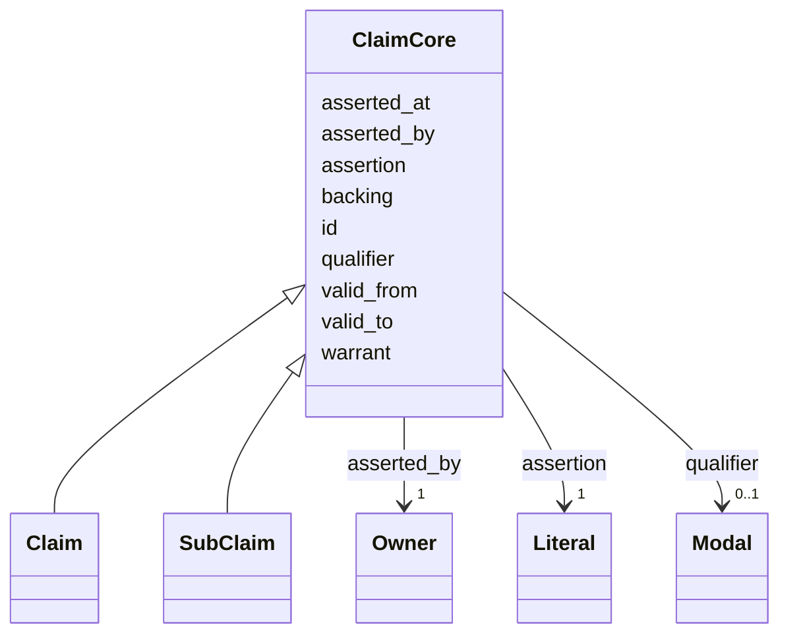

---
search:
  boost: 10.0
---

# Class: ClaimCore 


_A Toulmin claim: an assertion about an asset by an asserter, in force from valid_from to valid_to (inclusive; open when absent), with warrant, backing and qualifier._


<div data-search-exclude markdown="1">


* __NOTE__: this is an abstract class and should not be instantiated directly


URI: [slice:ClaimCore](https://example.org/llm-policy-reasoning/spike-v3/slice/ClaimCore)





## Inheritance
* **ClaimCore**
    * [Claim](Claim.md)
    * [SubClaim](SubClaim.md)


## Slots

| Name | Cardinality and Range | Description | Inheritance |
| ---  | --- | --- | --- |
| [id](id.md) | 1 <br/> [String](String.md) |  | direct |
| [assertion](assertion.md) | 1 <br/> [Literal](Literal.md) | A literal, e | direct |
| [asserted_by](asserted_by.md) | 1 <br/> [Owner](Owner.md) |  | direct |
| [asserted_at](asserted_at.md) | 1 <br/> [date](date.md) |  | direct |
| [valid_from](valid_from.md) | 1 <br/> [date](date.md) |  | direct |
| [valid_to](valid_to.md) | 0..1 <br/> [date](date.md) |  | direct |
| [warrant](warrant.md) | 0..1 <br/> [String](String.md) |  | direct |
| [backing](backing.md) | 0..1 <br/> [String](String.md) |  | direct |
| [qualifier](qualifier.md) | 0..1 <br/> [Modal](Modal.md) |  | direct |


## Identifier and Mapping Information


### Schema Source


* from schema: https://example.org/llm-policy-reasoning/spike-v3/slice


## Mappings

| Mapping Type | Mapped Value |
| ---  | ---  |
| self | slice:ClaimCore |
| native | slice:ClaimCore |


## LinkML Source

<!-- TODO: investigate https://stackoverflow.com/questions/37606292/how-to-create-tabbed-code-blocks-in-mkdocs-or-sphinx -->

### Direct

<details>
```yaml
name: ClaimCore
description: 'A Toulmin claim: an assertion about an asset by an asserter, in force
  from valid_from to valid_to (inclusive; open when absent), with warrant, backing
  and qualifier.'
from_schema: https://example.org/llm-policy-reasoning/spike-v3/slice
abstract: true
slots:
- id
- assertion
- asserted_by
- asserted_at
- valid_from
- valid_to
- warrant
- backing
- qualifier
slot_usage:
  id:
    name: id
    pattern: ^C[0-9]+(\.[0-9]+)?$
  assertion:
    name: assertion
    required: true
  asserted_by:
    name: asserted_by
    required: true
  asserted_at:
    name: asserted_at
    required: true
  valid_from:
    name: valid_from
    required: true

```
</details>

### Induced

<details>
```yaml
name: ClaimCore
description: 'A Toulmin claim: an assertion about an asset by an asserter, in force
  from valid_from to valid_to (inclusive; open when absent), with warrant, backing
  and qualifier.'
from_schema: https://example.org/llm-policy-reasoning/spike-v3/slice
abstract: true
slot_usage:
  id:
    name: id
    pattern: ^C[0-9]+(\.[0-9]+)?$
  assertion:
    name: assertion
    required: true
  asserted_by:
    name: asserted_by
    required: true
  asserted_at:
    name: asserted_at
    required: true
  valid_from:
    name: valid_from
    required: true
attributes:
  id:
    name: id
    from_schema: https://example.org/llm-policy-reasoning/spike-v3/slice
    rank: 1000
    identifier: true
    owner: ClaimCore
    domain_of:
    - Asset
    - Table
    - Column
    - Concept
    - Term
    - CodeList
    - Taxonomy
    - Rule
    - ClaimCore
    range: string
    required: true
    pattern: ^C[0-9]+(\.[0-9]+)?$
  assertion:
    name: assertion
    description: A literal, e.g. [:cost_centre_of "e077" "cc0078"].
    from_schema: https://example.org/llm-policy-reasoning/spike-v3/slice
    rank: 1000
    owner: ClaimCore
    domain_of:
    - ClaimCore
    range: Literal
    required: true
    inlined: true
  asserted_by:
    name: asserted_by
    from_schema: https://example.org/llm-policy-reasoning/spike-v3/slice
    rank: 1000
    owner: ClaimCore
    domain_of:
    - ClaimCore
    range: Owner
    required: true
  asserted_at:
    name: asserted_at
    from_schema: https://example.org/llm-policy-reasoning/spike-v3/slice
    rank: 1000
    owner: ClaimCore
    domain_of:
    - ClaimCore
    range: date
    required: true
  valid_from:
    name: valid_from
    from_schema: https://example.org/llm-policy-reasoning/spike-v3/slice
    rank: 1000
    owner: ClaimCore
    domain_of:
    - ClaimCore
    range: date
    required: true
  valid_to:
    name: valid_to
    from_schema: https://example.org/llm-policy-reasoning/spike-v3/slice
    rank: 1000
    owner: ClaimCore
    domain_of:
    - ClaimCore
    range: date
  warrant:
    name: warrant
    from_schema: https://example.org/llm-policy-reasoning/spike-v3/slice
    rank: 1000
    owner: ClaimCore
    domain_of:
    - ClaimCore
    range: string
    pattern: ^R[0-9]+$
  backing:
    name: backing
    from_schema: https://example.org/llm-policy-reasoning/spike-v3/slice
    rank: 1000
    owner: ClaimCore
    domain_of:
    - ClaimCore
    range: string
  qualifier:
    name: qualifier
    from_schema: https://example.org/llm-policy-reasoning/spike-v3/slice
    rank: 1000
    owner: ClaimCore
    domain_of:
    - ClaimCore
    range: Modal

```
</details></div>