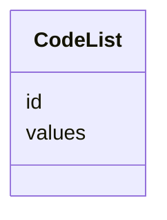

---
search:
  boost: 10.0
---

# Class: CodeList 


_The admissible codes of an enumerated column._


<div data-search-exclude markdown="1">


URI: [slice:CodeList](https://example.org/llm-policy-reasoning/spike-v3/slice/CodeList)





<!-- no inheritance hierarchy -->

## Slots

| Name | Cardinality and Range | Description | Inheritance |
| ---  | --- | --- | --- |
| [id](id.md) | 1 <br/> [String](String.md) |  | direct |
| [values](values.md) | 1..* <br/> [String](String.md) |  | direct |


## Usages

| used by | used in | type | used |
| ---  | --- | --- | --- |
| [Slice](Slice.md) | [code_lists](code_lists.md) | range | [CodeList](CodeList.md) |


## Identifier and Mapping Information


### Schema Source


* from schema: https://example.org/llm-policy-reasoning/spike-v3/slice


## Mappings

| Mapping Type | Mapped Value |
| ---  | ---  |
| self | slice:CodeList |
| native | slice:CodeList |


## LinkML Source

<!-- TODO: investigate https://stackoverflow.com/questions/37606292/how-to-create-tabbed-code-blocks-in-mkdocs-or-sphinx -->

### Direct

<details>
```yaml
name: CodeList
description: The admissible codes of an enumerated column.
from_schema: https://example.org/llm-policy-reasoning/spike-v3/slice
slots:
- id
- values

```
</details>

### Induced

<details>
```yaml
name: CodeList
description: The admissible codes of an enumerated column.
from_schema: https://example.org/llm-policy-reasoning/spike-v3/slice
attributes:
  id:
    name: id
    from_schema: https://example.org/llm-policy-reasoning/spike-v3/slice
    rank: 1000
    identifier: true
    owner: CodeList
    domain_of:
    - Asset
    - Table
    - Column
    - Concept
    - Term
    - CodeList
    - Taxonomy
    - Rule
    - Claim
    range: string
    required: true
  values:
    name: values
    from_schema: https://example.org/llm-policy-reasoning/spike-v3/slice
    rank: 1000
    owner: CodeList
    domain_of:
    - CodeList
    range: string
    required: true
    multivalued: true

```
</details></div>