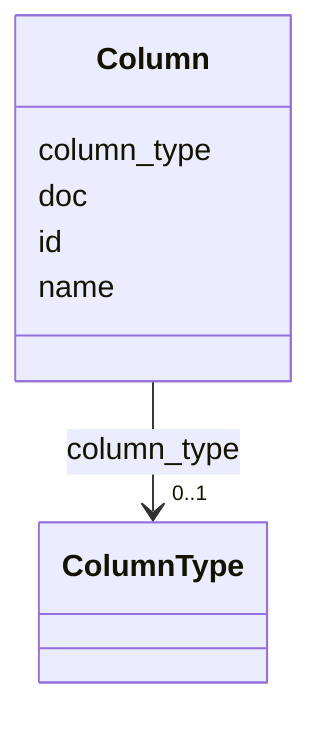

---
search:
  boost: 10.0
---

# Class: Column 


_A column of a physical table._


<div data-search-exclude markdown="1">


URI: [slice:Column](https://example.org/llm-policy-reasoning/spike-v3/slice/Column)





<!-- no inheritance hierarchy -->

## Slots

| Name | Cardinality and Range | Description | Inheritance |
| ---  | --- | --- | --- |
| [id](id.md) | 1 <br/> [String](String.md) |  | direct |
| [name](name.md) | 0..1 <br/> [String](String.md) |  | direct |
| [column_type](column_type.md) | 0..1 <br/> [ColumnType](ColumnType.md) |  | direct |
| [doc](doc.md) | 0..1 <br/> [String](String.md) |  | direct |


## Usages

| used by | used in | type | used |
| ---  | --- | --- | --- |
| [Table](Table.md) | [columns](columns.md) | range | [Column](Column.md) |


## Identifier and Mapping Information


### Schema Source


* from schema: https://example.org/llm-policy-reasoning/spike-v3/slice


## Mappings

| Mapping Type | Mapped Value |
| ---  | ---  |
| self | slice:Column |
| native | slice:Column |


## LinkML Source

<!-- TODO: investigate https://stackoverflow.com/questions/37606292/how-to-create-tabbed-code-blocks-in-mkdocs-or-sphinx -->

### Direct

<details>
```yaml
name: Column
description: A column of a physical table.
from_schema: https://example.org/llm-policy-reasoning/spike-v3/slice
slots:
- id
- name
- column_type
- doc
slot_usage:
  id:
    name: id
    pattern: ^col:[a-z_]+/[a-z_]+$

```
</details>

### Induced

<details>
```yaml
name: Column
description: A column of a physical table.
from_schema: https://example.org/llm-policy-reasoning/spike-v3/slice
slot_usage:
  id:
    name: id
    pattern: ^col:[a-z_]+/[a-z_]+$
attributes:
  id:
    name: id
    from_schema: https://example.org/llm-policy-reasoning/spike-v3/slice
    rank: 1000
    identifier: true
    owner: Column
    domain_of:
    - Asset
    - Table
    - Column
    - Concept
    - Term
    - CodeList
    - Taxonomy
    - Rule
    - ClaimCore
    range: string
    required: true
    pattern: ^col:[a-z_]+/[a-z_]+$
  name:
    name: name
    from_schema: https://example.org/llm-policy-reasoning/spike-v3/slice
    rank: 1000
    owner: Column
    domain_of:
    - Table
    - Column
    range: string
  column_type:
    name: column_type
    from_schema: https://example.org/llm-policy-reasoning/spike-v3/slice
    rank: 1000
    owner: Column
    domain_of:
    - Column
    range: ColumnType
  doc:
    name: doc
    from_schema: https://example.org/llm-policy-reasoning/spike-v3/slice
    rank: 1000
    owner: Column
    domain_of:
    - Asset
    - Table
    - Column
    - Concept
    - Rule
    range: string

```
</details></div>