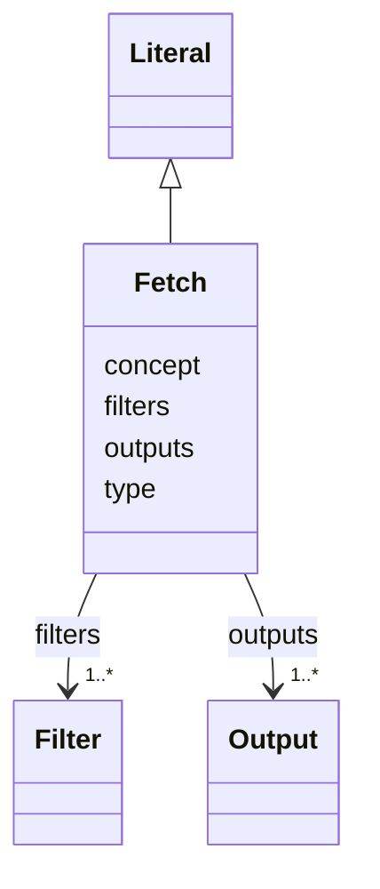

---
search:
  boost: 10.0
---

# Class: Fetch 


_[:fetch :concept {col term} {col ?var}]: a concept lookup; bound terms filter, variables bind._


<div data-search-exclude markdown="1">


URI: [slice:Fetch](https://example.org/llm-policy-reasoning/spike-v3/slice/Fetch)





## Inheritance
* [Literal](Literal.md)
    * **Fetch**


## Slots

| Name | Cardinality and Range | Description | Inheritance |
| ---  | --- | --- | --- |
| [concept](concept.md) | 1 <br/> [String](String.md) |  | direct |
| [filters](filters.md) | 1..* <br/> [Filter](Filter.md) |  | direct |
| [outputs](outputs.md) | 1..* <br/> [Output](Output.md) |  | direct |
| [type](type.md) | 1 <br/> [String](String.md) |  | [Literal](Literal.md) |


## Identifier and Mapping Information


### Schema Source


* from schema: https://example.org/llm-policy-reasoning/spike-v3/slice


## Mappings

| Mapping Type | Mapped Value |
| ---  | ---  |
| self | slice:Fetch |
| native | slice:Fetch |


## LinkML Source

<!-- TODO: investigate https://stackoverflow.com/questions/37606292/how-to-create-tabbed-code-blocks-in-mkdocs-or-sphinx -->

### Direct

<details>
```yaml
name: Fetch
description: '[:fetch :concept {col term} {col ?var}]: a concept lookup; bound terms
  filter, variables bind.'
from_schema: https://example.org/llm-policy-reasoning/spike-v3/slice
is_a: Literal
attributes:
  concept:
    name: concept
    from_schema: https://example.org/llm-policy-reasoning/spike-v3/slice
    domain_of:
    - Term
    - Fetch
    required: true
    pattern: ^[a-z_]+$
  filters:
    name: filters
    from_schema: https://example.org/llm-policy-reasoning/spike-v3/slice
    rank: 1000
    domain_of:
    - Fetch
    range: Filter
    required: true
    multivalued: true
    inlined: true
  outputs:
    name: outputs
    from_schema: https://example.org/llm-policy-reasoning/spike-v3/slice
    rank: 1000
    domain_of:
    - Fetch
    range: Output
    required: true
    multivalued: true
    inlined: true

```
</details>

### Induced

<details>
```yaml
name: Fetch
description: '[:fetch :concept {col term} {col ?var}]: a concept lookup; bound terms
  filter, variables bind.'
from_schema: https://example.org/llm-policy-reasoning/spike-v3/slice
is_a: Literal
attributes:
  concept:
    name: concept
    from_schema: https://example.org/llm-policy-reasoning/spike-v3/slice
    owner: Fetch
    domain_of:
    - Term
    - Fetch
    range: string
    required: true
    pattern: ^[a-z_]+$
  filters:
    name: filters
    from_schema: https://example.org/llm-policy-reasoning/spike-v3/slice
    rank: 1000
    owner: Fetch
    domain_of:
    - Fetch
    range: Filter
    required: true
    multivalued: true
    inlined: true
  outputs:
    name: outputs
    from_schema: https://example.org/llm-policy-reasoning/spike-v3/slice
    rank: 1000
    owner: Fetch
    domain_of:
    - Fetch
    range: Output
    required: true
    multivalued: true
    inlined: true
  type:
    name: type
    from_schema: https://example.org/llm-policy-reasoning/spike-v3/slice
    rank: 1000
    designates_type: true
    owner: Fetch
    domain_of:
    - Literal
    - RuleTerm
    range: string
    required: true

```
</details></div>