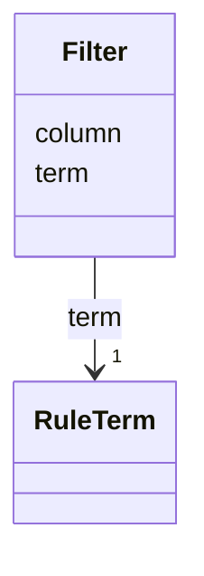

---
search:
  boost: 10.0
---

# Class: Filter 


_One entry of a fetch filter map (compact form `column: term`)._


<div data-search-exclude markdown="1">


URI: [slice:Filter](https://example.org/llm-policy-reasoning/spike-v3/slice/Filter)





<!-- no inheritance hierarchy -->

## Slots

| Name | Cardinality and Range | Description | Inheritance |
| ---  | --- | --- | --- |
| [column](column.md) | 1 <br/> [String](String.md) |  | direct |
| [term](term.md) | 1 <br/> [RuleTerm](RuleTerm.md) |  | direct |


## Usages

| used by | used in | type | used |
| ---  | --- | --- | --- |
| [Fetch](Fetch.md) | [filters](filters.md) | range | [Filter](Filter.md) |


## Identifier and Mapping Information


### Schema Source


* from schema: https://example.org/llm-policy-reasoning/spike-v3/slice


## Mappings

| Mapping Type | Mapped Value |
| ---  | ---  |
| self | slice:Filter |
| native | slice:Filter |


## LinkML Source

<!-- TODO: investigate https://stackoverflow.com/questions/37606292/how-to-create-tabbed-code-blocks-in-mkdocs-or-sphinx -->

### Direct

<details>
```yaml
name: Filter
description: 'One entry of a fetch filter map (compact form `column: term`).'
from_schema: https://example.org/llm-policy-reasoning/spike-v3/slice
attributes:
  column:
    name: column
    from_schema: https://example.org/llm-policy-reasoning/spike-v3/slice
    rank: 1000
    key: true
    domain_of:
    - Filter
    - Output
  term:
    name: term
    from_schema: https://example.org/llm-policy-reasoning/spike-v3/slice
    rank: 1000
    domain_of:
    - Filter
    range: RuleTerm
    required: true
    inlined: true

```
</details>

### Induced

<details>
```yaml
name: Filter
description: 'One entry of a fetch filter map (compact form `column: term`).'
from_schema: https://example.org/llm-policy-reasoning/spike-v3/slice
attributes:
  column:
    name: column
    from_schema: https://example.org/llm-policy-reasoning/spike-v3/slice
    rank: 1000
    key: true
    owner: Filter
    domain_of:
    - Filter
    - Output
    range: string
    required: true
  term:
    name: term
    from_schema: https://example.org/llm-policy-reasoning/spike-v3/slice
    rank: 1000
    owner: Filter
    domain_of:
    - Filter
    range: RuleTerm
    required: true
    inlined: true

```
</details></div>