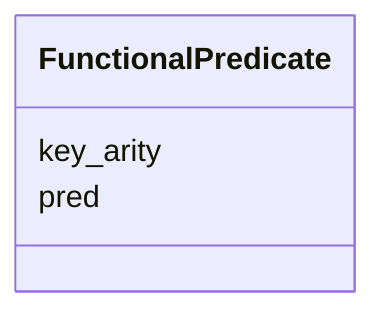

---
search:
  boost: 10.0
---

# Class: FunctionalPredicate 


_A predicate whose first key_arity arguments are a key and whose last argument is a value; two conclusions with the same key and different values compete as p and ~p do._


<div data-search-exclude markdown="1">


URI: [slice:FunctionalPredicate](https://example.org/llm-policy-reasoning/spike-v3/slice/FunctionalPredicate)





<!-- no inheritance hierarchy -->

## Slots

| Name | Cardinality and Range | Description | Inheritance |
| ---  | --- | --- | --- |
| [pred](pred.md) | 0..1 <br/> [String](String.md) |  | direct |
| [key_arity](key_arity.md) | 0..1 <br/> [Integer](Integer.md) |  | direct |


## Usages

| used by | used in | type | used |
| ---  | --- | --- | --- |
| [Slice](Slice.md) | [functional](functional.md) | range | [FunctionalPredicate](FunctionalPredicate.md) |


## Identifier and Mapping Information


### Schema Source


* from schema: https://example.org/llm-policy-reasoning/spike-v3/slice


## Mappings

| Mapping Type | Mapped Value |
| ---  | ---  |
| self | slice:FunctionalPredicate |
| native | slice:FunctionalPredicate |


## LinkML Source

<!-- TODO: investigate https://stackoverflow.com/questions/37606292/how-to-create-tabbed-code-blocks-in-mkdocs-or-sphinx -->

### Direct

<details>
```yaml
name: FunctionalPredicate
description: A predicate whose first key_arity arguments are a key and whose last
  argument is a value; two conclusions with the same key and different values compete
  as p and ~p do.
from_schema: https://example.org/llm-policy-reasoning/spike-v3/slice
slots:
- pred
- key_arity

```
</details>

### Induced

<details>
```yaml
name: FunctionalPredicate
description: A predicate whose first key_arity arguments are a key and whose last
  argument is a value; two conclusions with the same key and different values compete
  as p and ~p do.
from_schema: https://example.org/llm-policy-reasoning/spike-v3/slice
attributes:
  pred:
    name: pred
    from_schema: https://example.org/llm-policy-reasoning/spike-v3/slice
    rank: 1000
    owner: FunctionalPredicate
    domain_of:
    - FunctionalPredicate
    - Rule
    range: string
  key_arity:
    name: key_arity
    from_schema: https://example.org/llm-policy-reasoning/spike-v3/slice
    rank: 1000
    owner: FunctionalPredicate
    domain_of:
    - FunctionalPredicate
    range: integer
    minimum_value: 1

```
</details></div>