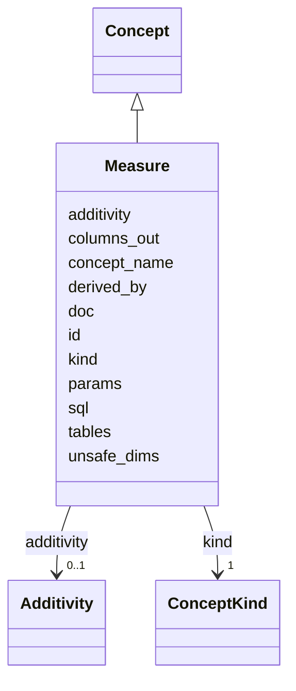

---
search:
  boost: 10.0
---

# Class: Measure 


_A concept whose kind is measure (an aggregate over the detail data)._


<div data-search-exclude markdown="1">


URI: [slice:Measure](https://example.org/llm-policy-reasoning/spike-v3/slice/Measure)





## Inheritance
* [Concept](Concept.md)
    * **Measure**


## Slots

| Name | Cardinality and Range | Description | Inheritance |
| ---  | --- | --- | --- |
| [id](id.md) | 1 <br/> [String](String.md) |  | [Concept](Concept.md) |
| [concept_name](concept_name.md) | 0..1 <br/> [String](String.md) | The concept's name as rules reference it in fetch literals | [Concept](Concept.md) |
| [kind](kind.md) | 1 <br/> [ConceptKind](ConceptKind.md) |  | [Concept](Concept.md) |
| [doc](doc.md) | 0..1 <br/> [String](String.md) |  | [Concept](Concept.md) |
| [tables](tables.md) | 1..* <br/> [String](String.md) | Ids of the tables the concept binds to | [Concept](Concept.md) |
| [params](params.md) | * <br/> [String](String.md) |  | [Concept](Concept.md) |
| [columns_out](columns_out.md) | * <br/> [String](String.md) | Output columns of the concept's rows | [Concept](Concept.md) |
| [sql](sql.md) | 0..1 <br/> [String](String.md) |  | [Concept](Concept.md) |
| [derived_by](derived_by.md) | 0..1 <br/> [String](String.md) |  | [Concept](Concept.md) |
| [additivity](additivity.md) | 0..1 <br/> [Additivity](Additivity.md) |  | [Concept](Concept.md) |
| [unsafe_dims](unsafe_dims.md) | * <br/> [String](String.md) | Dimensions a semi-additive measure must not be summed over | [Concept](Concept.md) |

<details>
<summary>Expressions & Logic</summary>
#### Any Of

The class must satisfy at least one of:
- AnonymousClassExpression({'slot_conditions': {'sql': SlotDefinition({'name': 'sql', 'required': True})}})
- AnonymousClassExpression({
  'slot_conditions': {'derived_by': SlotDefinition({'name': 'derived_by', 'required': True})}
})

</details>


## Identifier and Mapping Information


### Schema Source


* from schema: https://example.org/llm-policy-reasoning/spike-v3/slice


## Mappings

| Mapping Type | Mapped Value |
| ---  | ---  |
| self | slice:Measure |
| native | slice:Measure |


## LinkML Source

<!-- TODO: investigate https://stackoverflow.com/questions/37606292/how-to-create-tabbed-code-blocks-in-mkdocs-or-sphinx -->

### Direct

<details>
```yaml
name: Measure
description: A concept whose kind is measure (an aggregate over the detail data).
from_schema: https://example.org/llm-policy-reasoning/spike-v3/slice
is_a: Concept
any_of:
- slot_conditions:
    sql:
      name: sql
      required: true
- slot_conditions:
    derived_by:
      name: derived_by
      required: true

```
</details>

### Induced

<details>
```yaml
name: Measure
description: A concept whose kind is measure (an aggregate over the detail data).
from_schema: https://example.org/llm-policy-reasoning/spike-v3/slice
is_a: Concept
attributes:
  id:
    name: id
    from_schema: https://example.org/llm-policy-reasoning/spike-v3/slice
    rank: 1000
    identifier: true
    owner: Measure
    domain_of:
    - Asset
    - Table
    - Column
    - Concept
    - Term
    - CodeList
    - Taxonomy
    - Rule
    - Claim
    range: string
    required: true
  concept_name:
    name: concept_name
    description: The concept's name as rules reference it in fetch literals.
    from_schema: https://example.org/llm-policy-reasoning/spike-v3/slice
    rank: 1000
    owner: Measure
    domain_of:
    - Concept
    range: string
  kind:
    name: kind
    from_schema: https://example.org/llm-policy-reasoning/spike-v3/slice
    rank: 1000
    owner: Measure
    domain_of:
    - Asset
    - Concept
    - Rule
    range: ConceptKind
    required: true
  doc:
    name: doc
    from_schema: https://example.org/llm-policy-reasoning/spike-v3/slice
    rank: 1000
    owner: Measure
    domain_of:
    - Asset
    - Table
    - Column
    - Concept
    - Rule
    range: string
  tables:
    name: tables
    description: Ids of the tables the concept binds to.
    from_schema: https://example.org/llm-policy-reasoning/spike-v3/slice
    rank: 1000
    owner: Measure
    domain_of:
    - Slice
    - Concept
    range: string
    required: true
    multivalued: true
    inlined: true
    inlined_as_list: true
  params:
    name: params
    from_schema: https://example.org/llm-policy-reasoning/spike-v3/slice
    rank: 1000
    owner: Measure
    domain_of:
    - Concept
    range: string
    multivalued: true
  columns_out:
    name: columns_out
    description: Output columns of the concept's rows.
    from_schema: https://example.org/llm-policy-reasoning/spike-v3/slice
    rank: 1000
    owner: Measure
    domain_of:
    - Concept
    range: string
    multivalued: true
  sql:
    name: sql
    from_schema: https://example.org/llm-policy-reasoning/spike-v3/slice
    rank: 1000
    owner: Measure
    domain_of:
    - Concept
    range: string
  derived_by:
    name: derived_by
    from_schema: https://example.org/llm-policy-reasoning/spike-v3/slice
    rank: 1000
    owner: Measure
    domain_of:
    - Concept
    range: string
    pattern: ^R[0-9]+$
  additivity:
    name: additivity
    from_schema: https://example.org/llm-policy-reasoning/spike-v3/slice
    rank: 1000
    owner: Measure
    domain_of:
    - Concept
    range: Additivity
  unsafe_dims:
    name: unsafe_dims
    description: Dimensions a semi-additive measure must not be summed over.
    from_schema: https://example.org/llm-policy-reasoning/spike-v3/slice
    rank: 1000
    owner: Measure
    domain_of:
    - Concept
    range: string
    multivalued: true
any_of:
- slot_conditions:
    sql:
      name: sql
      required: true
- slot_conditions:
    derived_by:
      name: derived_by
      required: true

```
</details></div>