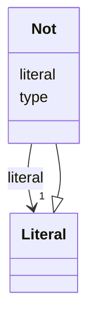

---
search:
  boost: 10.0
---

# Class: Not 


_[:not literal]: the literal is not defeasibly provable._


<div data-search-exclude markdown="1">


URI: [slice:Not](https://example.org/llm-policy-reasoning/spike-v3/slice/Not)





## Inheritance
* [Literal](Literal.md)
    * **Not**


## Slots

| Name | Cardinality and Range | Description | Inheritance |
| ---  | --- | --- | --- |
| [literal](literal.md) | 1 <br/> [Literal](Literal.md) |  | direct |
| [type](type.md) | 1 <br/> [String](String.md) |  | [Literal](Literal.md) |


## Identifier and Mapping Information


### Schema Source


* from schema: https://example.org/llm-policy-reasoning/spike-v3/slice


## Mappings

| Mapping Type | Mapped Value |
| ---  | ---  |
| self | slice:Not |
| native | slice:Not |


## LinkML Source

<!-- TODO: investigate https://stackoverflow.com/questions/37606292/how-to-create-tabbed-code-blocks-in-mkdocs-or-sphinx -->

### Direct

<details>
```yaml
name: Not
description: '[:not literal]: the literal is not defeasibly provable.'
from_schema: https://example.org/llm-policy-reasoning/spike-v3/slice
is_a: Literal
attributes:
  literal:
    name: literal
    from_schema: https://example.org/llm-policy-reasoning/spike-v3/slice
    rank: 1000
    domain_of:
    - Not
    - Neg
    range: Literal
    required: true
    inlined: true

```
</details>

### Induced

<details>
```yaml
name: Not
description: '[:not literal]: the literal is not defeasibly provable.'
from_schema: https://example.org/llm-policy-reasoning/spike-v3/slice
is_a: Literal
attributes:
  literal:
    name: literal
    from_schema: https://example.org/llm-policy-reasoning/spike-v3/slice
    rank: 1000
    owner: Not
    domain_of:
    - Not
    - Neg
    range: Literal
    required: true
    inlined: true
  type:
    name: type
    from_schema: https://example.org/llm-policy-reasoning/spike-v3/slice
    rank: 1000
    designates_type: true
    owner: Not
    domain_of:
    - Literal
    - RuleTerm
    range: string
    required: true

```
</details></div>