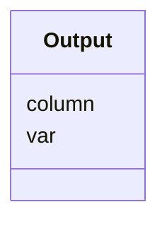

---
search:
  boost: 10.0
---

# Class: Output 


_One entry of a fetch output map (compact form `column: ?var`)._


<div data-search-exclude markdown="1">


URI: [slice:Output](https://example.org/llm-policy-reasoning/spike-v3/slice/Output)





<!-- no inheritance hierarchy -->

## Slots

| Name | Cardinality and Range | Description | Inheritance |
| ---  | --- | --- | --- |
| [column](column.md) | 1 <br/> [String](String.md) |  | direct |
| [var](var.md) | 1 <br/> [String](String.md) |  | direct |


## Usages

| used by | used in | type | used |
| ---  | --- | --- | --- |
| [Fetch](Fetch.md) | [outputs](outputs.md) | range | [Output](Output.md) |


## Identifier and Mapping Information


### Schema Source


* from schema: https://example.org/llm-policy-reasoning/spike-v3/slice


## Mappings

| Mapping Type | Mapped Value |
| ---  | ---  |
| self | slice:Output |
| native | slice:Output |


## LinkML Source

<!-- TODO: investigate https://stackoverflow.com/questions/37606292/how-to-create-tabbed-code-blocks-in-mkdocs-or-sphinx -->

### Direct

<details>
```yaml
name: Output
description: 'One entry of a fetch output map (compact form `column: ?var`).'
from_schema: https://example.org/llm-policy-reasoning/spike-v3/slice
attributes:
  column:
    name: column
    from_schema: https://example.org/llm-policy-reasoning/spike-v3/slice
    key: true
    domain_of:
    - Filter
    - Output
  var:
    name: var
    from_schema: https://example.org/llm-policy-reasoning/spike-v3/slice
    rank: 1000
    domain_of:
    - Output
    - Is
    - Aggregate
    required: true
    pattern: ^\?[A-Za-z_][A-Za-z0-9_]*$

```
</details>

### Induced

<details>
```yaml
name: Output
description: 'One entry of a fetch output map (compact form `column: ?var`).'
from_schema: https://example.org/llm-policy-reasoning/spike-v3/slice
attributes:
  column:
    name: column
    from_schema: https://example.org/llm-policy-reasoning/spike-v3/slice
    key: true
    owner: Output
    domain_of:
    - Filter
    - Output
    range: string
    required: true
  var:
    name: var
    from_schema: https://example.org/llm-policy-reasoning/spike-v3/slice
    rank: 1000
    owner: Output
    domain_of:
    - Output
    - Is
    - Aggregate
    range: string
    required: true
    pattern: ^\?[A-Za-z_][A-Za-z0-9_]*$

```
</details></div>