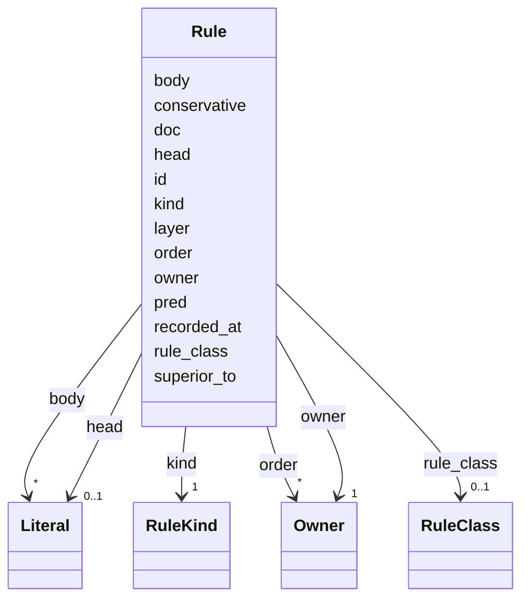

---
search:
  boost: 10.0
---

# Class: Rule 


_A rule envelope. kind strict, defeasible or defeater carries head and body; superiority carries pred and order (asserter authority); incompatible carries head and body (head excluded when body holds)._


<div data-search-exclude markdown="1">


URI: [slice:Rule](https://example.org/llm-policy-reasoning/spike-v3/slice/Rule)





<!-- no inheritance hierarchy -->

## Slots

| Name | Cardinality and Range | Description | Inheritance |
| ---  | --- | --- | --- |
| [id](id.md) | 1 <br/> [String](String.md) |  | direct |
| [kind](kind.md) | 1 <br/> [RuleKind](RuleKind.md) |  | direct |
| [owner](owner.md) | 1 <br/> [Owner](Owner.md) |  | direct |
| [rule_class](rule_class.md) | 0..1 <br/> [RuleClass](RuleClass.md) |  | direct |
| [conservative](conservative.md) | 0..1 <br/> [Boolean](Boolean.md) |  | direct |
| [layer](layer.md) | 0..1 <br/> [String](String.md) |  | direct |
| [doc](doc.md) | 0..1 <br/> [String](String.md) |  | direct |
| [head](head.md) | 0..1 <br/> [Literal](Literal.md) | A literal, e | direct |
| [body](body.md) | * <br/> [Literal](Literal.md) | Literals, evaluated left to right | direct |
| [superior_to](superior_to.md) | * <br/> [String](String.md) |  | direct |
| [pred](pred.md) | 0..1 <br/> [String](String.md) |  | direct |
| [order](order.md) | * <br/> [Owner](Owner.md) | Asserter authority, strongest first | direct |
| [recorded_at](recorded_at.md) | 1 <br/> [date](date.md) | When the record entered the store (provenance; no rule body reads it) | direct |


## Usages

| used by | used in | type | used |
| ---  | --- | --- | --- |
| [Slice](Slice.md) | [rules](rules.md) | range | [Rule](Rule.md) |


## Rules


### 

| Rule Applied | Preconditions | Postconditions | Elseconditions |
|--------------|---------------|----------------|----------------|
| slot_conditions |```{'kind': {'equals_string': 'superiority'}}``` |```{'pred': {'required': True}, 'order': {'required': True}}``` | |


### 

| Rule Applied | Preconditions | Postconditions | Elseconditions |
|--------------|---------------|----------------|----------------|
| slot_conditions |```{'kind': {'any_of': [{'equals_string': 'strict'}, {'equals_string': 'defeasible'}, {'equals_string': 'defeater'}, {'equals_string': 'incompatible'}]}}``` |```{'head': {'required': True}}``` | |


## Identifier and Mapping Information


### Schema Source


* from schema: https://example.org/llm-policy-reasoning/spike-v3/slice


## Mappings

| Mapping Type | Mapped Value |
| ---  | ---  |
| self | slice:Rule |
| native | slice:Rule |


## LinkML Source

<!-- TODO: investigate https://stackoverflow.com/questions/37606292/how-to-create-tabbed-code-blocks-in-mkdocs-or-sphinx -->

### Direct

<details>
```yaml
name: Rule
description: A rule envelope. kind strict, defeasible or defeater carries head and
  body; superiority carries pred and order (asserter authority); incompatible carries
  head and body (head excluded when body holds).
from_schema: https://example.org/llm-policy-reasoning/spike-v3/slice
slots:
- id
- kind
- owner
- rule_class
- conservative
- layer
- doc
- head
- body
- superior_to
- pred
- order
- recorded_at
slot_usage:
  id:
    name: id
    pattern: ^R[0-9]+$
  kind:
    name: kind
    range: RuleKind
    required: true
  owner:
    name: owner
    required: true
  recorded_at:
    name: recorded_at
    required: true
rules:
- preconditions:
    slot_conditions:
      kind:
        name: kind
        equals_string: superiority
  postconditions:
    slot_conditions:
      pred:
        name: pred
        required: true
      order:
        name: order
        required: true
- preconditions:
    slot_conditions:
      kind:
        name: kind
        any_of:
        - equals_string: strict
        - equals_string: defeasible
        - equals_string: defeater
        - equals_string: incompatible
  postconditions:
    slot_conditions:
      head:
        name: head
        required: true

```
</details>

### Induced

<details>
```yaml
name: Rule
description: A rule envelope. kind strict, defeasible or defeater carries head and
  body; superiority carries pred and order (asserter authority); incompatible carries
  head and body (head excluded when body holds).
from_schema: https://example.org/llm-policy-reasoning/spike-v3/slice
slot_usage:
  id:
    name: id
    pattern: ^R[0-9]+$
  kind:
    name: kind
    range: RuleKind
    required: true
  owner:
    name: owner
    required: true
  recorded_at:
    name: recorded_at
    required: true
attributes:
  id:
    name: id
    from_schema: https://example.org/llm-policy-reasoning/spike-v3/slice
    rank: 1000
    identifier: true
    owner: Rule
    domain_of:
    - Asset
    - Table
    - Column
    - Concept
    - Term
    - CodeList
    - Taxonomy
    - Rule
    - Claim
    range: string
    required: true
    pattern: ^R[0-9]+$
  kind:
    name: kind
    from_schema: https://example.org/llm-policy-reasoning/spike-v3/slice
    rank: 1000
    owner: Rule
    domain_of:
    - Asset
    - Concept
    - Rule
    range: RuleKind
    required: true
  owner:
    name: owner
    from_schema: https://example.org/llm-policy-reasoning/spike-v3/slice
    rank: 1000
    owner: Rule
    domain_of:
    - Term
    - Rule
    range: Owner
    required: true
  rule_class:
    name: rule_class
    from_schema: https://example.org/llm-policy-reasoning/spike-v3/slice
    rank: 1000
    owner: Rule
    domain_of:
    - Rule
    range: RuleClass
  conservative:
    name: conservative
    from_schema: https://example.org/llm-policy-reasoning/spike-v3/slice
    rank: 1000
    owner: Rule
    domain_of:
    - Rule
    range: boolean
  layer:
    name: layer
    from_schema: https://example.org/llm-policy-reasoning/spike-v3/slice
    rank: 1000
    owner: Rule
    domain_of:
    - Rule
    range: string
  doc:
    name: doc
    from_schema: https://example.org/llm-policy-reasoning/spike-v3/slice
    rank: 1000
    owner: Rule
    domain_of:
    - Asset
    - Table
    - Column
    - Concept
    - Rule
    range: string
  head:
    name: head
    description: A literal, e.g. [:headroom ?c ?h].
    from_schema: https://example.org/llm-policy-reasoning/spike-v3/slice
    rank: 1000
    owner: Rule
    domain_of:
    - Rule
    range: Literal
    inlined: true
  body:
    name: body
    description: Literals, evaluated left to right.
    from_schema: https://example.org/llm-policy-reasoning/spike-v3/slice
    rank: 1000
    owner: Rule
    domain_of:
    - Rule
    range: Literal
    multivalued: true
    inlined: true
    inlined_as_list: true
  superior_to:
    name: superior_to
    from_schema: https://example.org/llm-policy-reasoning/spike-v3/slice
    rank: 1000
    owner: Rule
    domain_of:
    - Rule
    range: string
    multivalued: true
    pattern: ^R[0-9]+$
  pred:
    name: pred
    from_schema: https://example.org/llm-policy-reasoning/spike-v3/slice
    rank: 1000
    owner: Rule
    domain_of:
    - FunctionalPredicate
    - Rule
    - Derived
    range: string
  order:
    name: order
    description: Asserter authority, strongest first.
    from_schema: https://example.org/llm-policy-reasoning/spike-v3/slice
    rank: 1000
    owner: Rule
    domain_of:
    - Rule
    range: Owner
    multivalued: true
  recorded_at:
    name: recorded_at
    description: When the record entered the store (provenance; no rule body reads
      it).
    from_schema: https://example.org/llm-policy-reasoning/spike-v3/slice
    rank: 1000
    owner: Rule
    domain_of:
    - Rule
    - Claim
    range: date
    required: true
rules:
- preconditions:
    slot_conditions:
      kind:
        name: kind
        equals_string: superiority
  postconditions:
    slot_conditions:
      pred:
        name: pred
        required: true
      order:
        name: order
        required: true
- preconditions:
    slot_conditions:
      kind:
        name: kind
        any_of:
        - equals_string: strict
        - equals_string: defeasible
        - equals_string: defeater
        - equals_string: incompatible
  postconditions:
    slot_conditions:
      head:
        name: head
        required: true

```
</details></div>