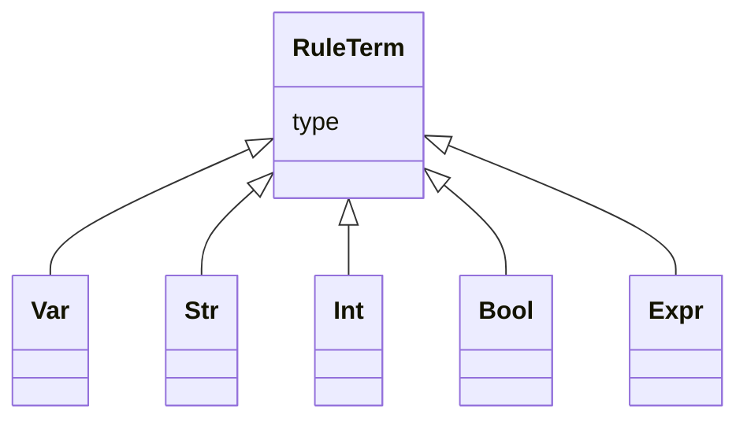

---
search:
  boost: 10.0
---

# Class: RuleTerm 


_An argument of a literal (named RuleTerm because Term is the vocabulary class)._


<div data-search-exclude markdown="1">


* __NOTE__: this is an abstract class and should not be instantiated directly


URI: [slice:RuleTerm](https://example.org/llm-policy-reasoning/spike-v3/slice/RuleTerm)





## Inheritance
* **RuleTerm**
    * [Var](Var.md)
    * [Str](Str.md)
    * [Int](Int.md)
    * [Bool](Bool.md)
    * [Expr](Expr.md)


## Slots

| Name | Cardinality and Range | Description | Inheritance |
| ---  | --- | --- | --- |
| [type](type.md) | 1 <br/> [String](String.md) |  | direct |


## Usages

| used by | used in | type | used |
| ---  | --- | --- | --- |
| [Derived](Derived.md) | [args](args.md) | range | [RuleTerm](RuleTerm.md) |
| [Filter](Filter.md) | [term](term.md) | range | [RuleTerm](RuleTerm.md) |
| [Comparison](Comparison.md) | [left](left.md) | range | [RuleTerm](RuleTerm.md) |
| [Comparison](Comparison.md) | [right](right.md) | range | [RuleTerm](RuleTerm.md) |
| [AsOf](AsOf.md) | [date](date.md) | range | [RuleTerm](RuleTerm.md) |
| [Expr](Expr.md) | [left](left.md) | range | [RuleTerm](RuleTerm.md) |
| [Expr](Expr.md) | [right](right.md) | range | [RuleTerm](RuleTerm.md) |


## Identifier and Mapping Information


### Schema Source


* from schema: https://example.org/llm-policy-reasoning/spike-v3/slice


## Mappings

| Mapping Type | Mapped Value |
| ---  | ---  |
| self | slice:RuleTerm |
| native | slice:RuleTerm |


## LinkML Source

<!-- TODO: investigate https://stackoverflow.com/questions/37606292/how-to-create-tabbed-code-blocks-in-mkdocs-or-sphinx -->

### Direct

<details>
```yaml
name: RuleTerm
description: An argument of a literal (named RuleTerm because Term is the vocabulary
  class).
from_schema: https://example.org/llm-policy-reasoning/spike-v3/slice
abstract: true
attributes:
  type:
    name: type
    from_schema: https://example.org/llm-policy-reasoning/spike-v3/slice
    designates_type: true
    domain_of:
    - Literal
    - RuleTerm
    range: string
    required: true

```
</details>

### Induced

<details>
```yaml
name: RuleTerm
description: An argument of a literal (named RuleTerm because Term is the vocabulary
  class).
from_schema: https://example.org/llm-policy-reasoning/spike-v3/slice
abstract: true
attributes:
  type:
    name: type
    from_schema: https://example.org/llm-policy-reasoning/spike-v3/slice
    designates_type: true
    owner: RuleTerm
    domain_of:
    - Literal
    - RuleTerm
    range: string
    required: true

```
</details></div>