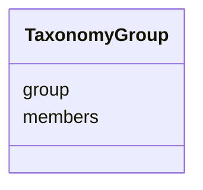

---
search:
  boost: 10.0
---

# Class: TaxonomyGroup 

<div data-search-exclude markdown="1">


URI: [slice:TaxonomyGroup](https://example.org/llm-policy-reasoning/spike-v3/slice/TaxonomyGroup)





<!-- no inheritance hierarchy -->

## Slots

| Name | Cardinality and Range | Description | Inheritance |
| ---  | --- | --- | --- |
| [group](group.md) | 0..1 <br/> [String](String.md) |  | direct |
| [members](members.md) | * <br/> [String](String.md) |  | direct |


## Usages

| used by | used in | type | used |
| ---  | --- | --- | --- |
| [Taxonomy](Taxonomy.md) | [groups](groups.md) | range | [TaxonomyGroup](TaxonomyGroup.md) |


## Identifier and Mapping Information


### Schema Source


* from schema: https://example.org/llm-policy-reasoning/spike-v3/slice


## Mappings

| Mapping Type | Mapped Value |
| ---  | ---  |
| self | slice:TaxonomyGroup |
| native | slice:TaxonomyGroup |


## LinkML Source

<!-- TODO: investigate https://stackoverflow.com/questions/37606292/how-to-create-tabbed-code-blocks-in-mkdocs-or-sphinx -->

### Direct

<details>
```yaml
name: TaxonomyGroup
from_schema: https://example.org/llm-policy-reasoning/spike-v3/slice
slots:
- group
- members

```
</details>

### Induced

<details>
```yaml
name: TaxonomyGroup
from_schema: https://example.org/llm-policy-reasoning/spike-v3/slice
attributes:
  group:
    name: group
    from_schema: https://example.org/llm-policy-reasoning/spike-v3/slice
    rank: 1000
    owner: TaxonomyGroup
    domain_of:
    - TaxonomyGroup
    range: string
  members:
    name: members
    from_schema: https://example.org/llm-policy-reasoning/spike-v3/slice
    rank: 1000
    owner: TaxonomyGroup
    domain_of:
    - TaxonomyGroup
    range: string
    multivalued: true

```
</details></div>