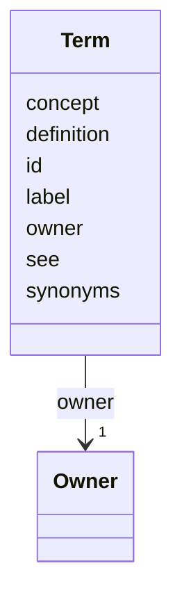

---
search:
  boost: 10.0
---

# Class: Term 


_A vocabulary term with a contrastive definition (X, as opposed to Y, differing in Z)._


<div data-search-exclude markdown="1">


URI: [slice:Term](https://example.org/llm-policy-reasoning/spike-v3/slice/Term)





<!-- no inheritance hierarchy -->

## Slots

| Name | Cardinality and Range | Description | Inheritance |
| ---  | --- | --- | --- |
| [id](id.md) | 1 <br/> [String](String.md) |  | direct |
| [label](label.md) | 1 <br/> [String](String.md) |  | direct |
| [synonyms](synonyms.md) | * <br/> [String](String.md) |  | direct |
| [owner](owner.md) | 1 <br/> [Owner](Owner.md) |  | direct |
| [concept](concept.md) | 0..1 <br/> [String](String.md) |  | direct |
| [see](see.md) | * <br/> [String](String.md) |  | direct |
| [definition](definition.md) | 1 <br/> [String](String.md) |  | direct |


## Usages

| used by | used in | type | used |
| ---  | --- | --- | --- |
| [Slice](Slice.md) | [terms](terms.md) | range | [Term](Term.md) |


## Identifier and Mapping Information


### Schema Source


* from schema: https://example.org/llm-policy-reasoning/spike-v3/slice


## Mappings

| Mapping Type | Mapped Value |
| ---  | ---  |
| self | slice:Term |
| native | slice:Term |


## LinkML Source

<!-- TODO: investigate https://stackoverflow.com/questions/37606292/how-to-create-tabbed-code-blocks-in-mkdocs-or-sphinx -->

### Direct

<details>
```yaml
name: Term
description: A vocabulary term with a contrastive definition (X, as opposed to Y,
  differing in Z).
from_schema: https://example.org/llm-policy-reasoning/spike-v3/slice
slots:
- id
- label
- synonyms
- owner
- concept
- see
- definition
slot_usage:
  id:
    name: id
    pattern: ^term:[a-z_]+$
  definition:
    name: definition
    required: true
  owner:
    name: owner
    required: true

```
</details>

### Induced

<details>
```yaml
name: Term
description: A vocabulary term with a contrastive definition (X, as opposed to Y,
  differing in Z).
from_schema: https://example.org/llm-policy-reasoning/spike-v3/slice
slot_usage:
  id:
    name: id
    pattern: ^term:[a-z_]+$
  definition:
    name: definition
    required: true
  owner:
    name: owner
    required: true
attributes:
  id:
    name: id
    from_schema: https://example.org/llm-policy-reasoning/spike-v3/slice
    rank: 1000
    identifier: true
    owner: Term
    domain_of:
    - Asset
    - Table
    - Column
    - Concept
    - Term
    - CodeList
    - Taxonomy
    - Rule
    - ClaimCore
    range: string
    required: true
    pattern: ^term:[a-z_]+$
  label:
    name: label
    from_schema: https://example.org/llm-policy-reasoning/spike-v3/slice
    rank: 1000
    owner: Term
    domain_of:
    - Term
    range: string
    required: true
  synonyms:
    name: synonyms
    from_schema: https://example.org/llm-policy-reasoning/spike-v3/slice
    rank: 1000
    owner: Term
    domain_of:
    - Term
    range: string
    multivalued: true
  owner:
    name: owner
    from_schema: https://example.org/llm-policy-reasoning/spike-v3/slice
    rank: 1000
    owner: Term
    domain_of:
    - Term
    - Rule
    range: Owner
    required: true
  concept:
    name: concept
    from_schema: https://example.org/llm-policy-reasoning/spike-v3/slice
    rank: 1000
    owner: Term
    domain_of:
    - Term
    range: string
    pattern: ^(measure|dim|entity|hier):[a-z_]+$
  see:
    name: see
    from_schema: https://example.org/llm-policy-reasoning/spike-v3/slice
    rank: 1000
    owner: Term
    domain_of:
    - Term
    range: string
    multivalued: true
  definition:
    name: definition
    from_schema: https://example.org/llm-policy-reasoning/spike-v3/slice
    rank: 1000
    owner: Term
    domain_of:
    - Term
    range: string
    required: true

```
</details></div>