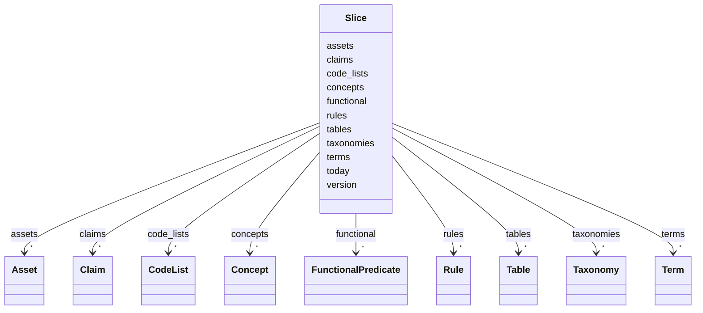

---
search:
  boost: 10.0
---

# Class: Slice 


_The whole slice, as authored in shared/slice.edn._


<div data-search-exclude markdown="1">


URI: [slice:Slice](https://example.org/llm-policy-reasoning/spike-v3/slice/Slice)





<!-- no inheritance hierarchy -->

## Class Properties

| Property | Value |
| --- | --- |
| Tree Root | Yes |


## Slots

| Name | Cardinality and Range | Description | Inheritance |
| ---  | --- | --- | --- |
| [version](version.md) | 0..1 <br/> [Integer](Integer.md) |  | direct |
| [today](today.md) | 1 <br/> [Date](Date.md) |  | direct |
| [assets](assets.md) | * <br/> [Asset](Asset.md) |  | direct |
| [tables](tables.md) | * <br/> [Table](Table.md) |  | direct |
| [concepts](concepts.md) | * <br/> [Concept](Concept.md) |  | direct |
| [terms](terms.md) | * <br/> [Term](Term.md) |  | direct |
| [code_lists](code_lists.md) | * <br/> [CodeList](CodeList.md) |  | direct |
| [taxonomies](taxonomies.md) | * <br/> [Taxonomy](Taxonomy.md) |  | direct |
| [functional](functional.md) | * <br/> [FunctionalPredicate](FunctionalPredicate.md) |  | direct |
| [rules](rules.md) | * <br/> [Rule](Rule.md) |  | direct |
| [claims](claims.md) | * <br/> [Claim](Claim.md) |  | direct |


## Identifier and Mapping Information


### Schema Source


* from schema: https://example.org/llm-policy-reasoning/spike-v3/slice


## Mappings

| Mapping Type | Mapped Value |
| ---  | ---  |
| self | slice:Slice |
| native | slice:Slice |


## LinkML Source

<!-- TODO: investigate https://stackoverflow.com/questions/37606292/how-to-create-tabbed-code-blocks-in-mkdocs-or-sphinx -->

### Direct

<details>
```yaml
name: Slice
description: The whole slice, as authored in shared/slice.edn.
from_schema: https://example.org/llm-policy-reasoning/spike-v3/slice
slots:
- version
- today
- assets
- tables
- concepts
- terms
- code_lists
- taxonomies
- functional
- rules
- claims
tree_root: true

```
</details>

### Induced

<details>
```yaml
name: Slice
description: The whole slice, as authored in shared/slice.edn.
from_schema: https://example.org/llm-policy-reasoning/spike-v3/slice
attributes:
  version:
    name: version
    from_schema: https://example.org/llm-policy-reasoning/spike-v3/slice
    rank: 1000
    owner: Slice
    domain_of:
    - Slice
    range: integer
  today:
    name: today
    from_schema: https://example.org/llm-policy-reasoning/spike-v3/slice
    rank: 1000
    owner: Slice
    domain_of:
    - Slice
    range: date
    required: true
  assets:
    name: assets
    from_schema: https://example.org/llm-policy-reasoning/spike-v3/slice
    rank: 1000
    owner: Slice
    domain_of:
    - Slice
    range: Asset
    multivalued: true
    inlined: true
    inlined_as_list: true
  tables:
    name: tables
    from_schema: https://example.org/llm-policy-reasoning/spike-v3/slice
    rank: 1000
    owner: Slice
    domain_of:
    - Slice
    - Concept
    range: Table
    multivalued: true
    inlined: true
    inlined_as_list: true
  concepts:
    name: concepts
    from_schema: https://example.org/llm-policy-reasoning/spike-v3/slice
    rank: 1000
    owner: Slice
    domain_of:
    - Slice
    range: Concept
    multivalued: true
    inlined: true
    inlined_as_list: true
  terms:
    name: terms
    from_schema: https://example.org/llm-policy-reasoning/spike-v3/slice
    rank: 1000
    owner: Slice
    domain_of:
    - Slice
    range: Term
    multivalued: true
    inlined: true
    inlined_as_list: true
  code_lists:
    name: code_lists
    from_schema: https://example.org/llm-policy-reasoning/spike-v3/slice
    rank: 1000
    owner: Slice
    domain_of:
    - Slice
    range: CodeList
    multivalued: true
    inlined: true
    inlined_as_list: true
  taxonomies:
    name: taxonomies
    from_schema: https://example.org/llm-policy-reasoning/spike-v3/slice
    rank: 1000
    owner: Slice
    domain_of:
    - Slice
    range: Taxonomy
    multivalued: true
    inlined: true
    inlined_as_list: true
  functional:
    name: functional
    from_schema: https://example.org/llm-policy-reasoning/spike-v3/slice
    rank: 1000
    owner: Slice
    domain_of:
    - Slice
    range: FunctionalPredicate
    multivalued: true
    inlined: true
    inlined_as_list: true
  rules:
    name: rules
    from_schema: https://example.org/llm-policy-reasoning/spike-v3/slice
    rank: 1000
    owner: Slice
    domain_of:
    - Slice
    range: Rule
    multivalued: true
    inlined: true
    inlined_as_list: true
  claims:
    name: claims
    from_schema: https://example.org/llm-policy-reasoning/spike-v3/slice
    rank: 1000
    owner: Slice
    domain_of:
    - Slice
    range: Claim
    multivalued: true
    inlined: true
    inlined_as_list: true
tree_root: true

```
</details></div>